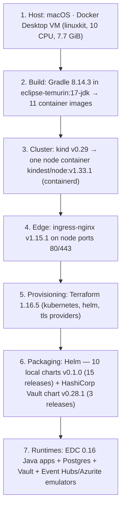
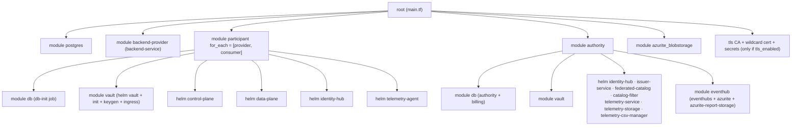
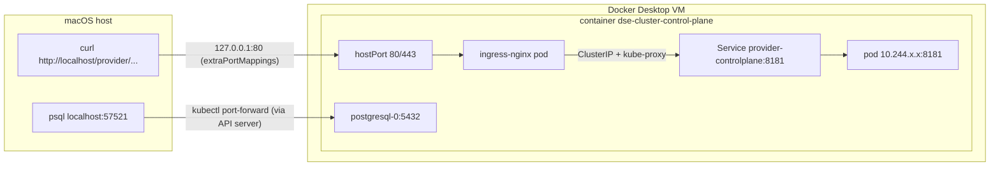

# Local MVD deployment — technology report

A long-form walkthrough of every technology involved in bringing up the DEPLOYTOUR / Eona-X Minimum Viable Dataspace on a laptop with `ging_deploy/deploy-local-mvd.sh`. For each technology the report covers what it is, why it is in this deployment, how it is configured here (real values taken from the running cluster and the upstream repository), and what to watch out for.

It is meant to be read top to bottom once, and then used as a reference. Companion documents:

- [README.md](README.md): what gets deployed, ports and ingress routes (the short version)
- [FLOWS.md](FLOWS.md): every functional flow, with commands
- [DIAGRAMS.md](DIAGRAMS.md): architecture, sequence and state diagrams, glossary

Everything below was observed on 2026-10-09 against `AmadeusITGroup/dataspace-ecosystem@e0c5200` (EDC 0.16.1), on macOS 14 arm64 with Docker Desktop, `TLS_ENABLED=false`.

---

## Contents

1. [The big picture: seven layers](#1-the-big-picture-seven-layers)
2. [Docker and container images](#2-docker-and-container-images)
3. [Java, Gradle and the image build](#3-java-gradle-and-the-image-build)
4. [kind: Kubernetes in Docker](#4-kind-kubernetes-in-docker)
5. [Kubernetes objects used](#5-kubernetes-objects-used)
6. [ingress-nginx](#6-ingress-nginx)
7. [Terraform](#7-terraform)
8. [Helm](#8-helm)
9. [Eclipse Dataspace Components (EDC) runtime configuration](#9-eclipse-dataspace-components-edc-runtime-configuration)
10. [The EDC/DSE components one by one](#10-the-edcdse-components-one-by-one)
11. [Identity: did:web, keys, Verifiable Credentials, DCP](#11-identity-didweb-keys-verifiable-credentials-dcp)
12. [HashiCorp Vault](#12-hashicorp-vault)
13. [PostgreSQL](#13-postgresql)
14. [Azure emulators: Event Hubs and Azurite](#14-azure-emulators-event-hubs-and-azurite)
15. [TLS mode (optional)](#15-tls-mode-optional)
16. [Networking end to end](#16-networking-end-to-end)
17. [The deployment script, step by step](#17-the-deployment-script-step-by-step)
18. [Lifecycle: what survives what](#18-lifecycle-what-survives-what)
19. [Security posture](#19-security-posture)
20. [Local vs. devbox (AWS) vs. target architecture](#20-local-vs-devbox-aws-vs-target-architecture)
21. [Troubleshooting cookbook](#21-troubleshooting-cookbook)
22. [Further reading](#22-further-reading)

---

## 1. The big picture: seven layers



Each layer depends only on the one below it:

| Layer | Answers the question | Tool |
| --- | --- | --- |
| Host | Where does it run? | Docker Desktop (a Linux VM on macOS) |
| Build | What code runs? | Gradle + Docker build |
| Cluster | Where do the containers get scheduled? | kind |
| Edge | How do I reach it from my laptop? | ingress-nginx, `kubectl port-forward` |
| Provisioning | What exists, in what order, with which config? | Terraform |
| Packaging | How is one component templated into Kubernetes objects? | Helm |
| Runtimes | What does each process do? | EDC + DSE extensions, infra images |

Each section below goes through one layer in that order.

---

## 2. Docker and container images

### What it is

Docker builds and runs OCI containers. On macOS, Docker Desktop runs a small Linux VM (kernel `7.0.14-linuxkit` here) and every container, including the kind "node", runs inside that VM. The VM's resources are the ceiling for the whole dataspace: **10 CPUs and 7.7 GiB of RAM** in this setup. Other containers you run (Mongo, Grafana, Redis…) share that budget.

### Why it is here

- To **build** the 11 EDC images (Gradle talks to the Docker daemon).
- To **run** kind: the Kubernetes node is itself a Docker container (`dse-cluster-control-plane`).
- To run the containerised Gradle build (`eclipse-temurin:17-jdk`).

### Image anatomy

All EDC launchers share the same Dockerfile shape (e.g. `launchers/control-plane/control-plane-postgresql-hashicorpvault/Dockerfile`):

```dockerfile
ARG REGISTRY_URL="quay.io/centos"
ARG BASE_IMAGE="centos:latest"
FROM ${REGISTRY_URL}/${BASE_IMAGE}                      # CentOS Stream from quay.io
ARG INSTALL_JAVA=true
RUN if [ "$INSTALL_JAVA" = "true" ]; then yum install java-21-openjdk -y; fi    # runtime JRE 21
ARG INSTALL_OPENSSL=true
RUN if [ "$INSTALL_OPENSSL" = "true" ]; then yum install openssl -y; fi
WORKDIR /app
RUN groupadd -g 1000 appuser && useradd -u 1000 -g appuser -s /bin/sh -m appuser
COPY ${JAR} controlplane.jar                            # shadow (fat) jar
COPY ${OTEL_JAR} opentelemetry-javaagent.jar
ENV WEB_HTTP_PORT="8080"            WEB_HTTP_PATH="/api"
ENV WEB_HTTP_MANAGEMENT_PORT="8181" WEB_HTTP_MANAGEMENT_PATH="/api/management"
ENV WEB_HTTP_PROTOCOL_PORT="8282"   WEB_HTTP_PROTOCOL_PATH="/api/dsp"
ENV WEB_HTTP_CONTROL_PORT="8383"    WEB_HTTP_CONTROL_PATH="/api/control"
ENV WEB_HTTP_ONBOARDING_PORT="8484" WEB_HTTP_ONBOARDING_PATH="/api/onboarding"
USER appuser
CMD ["java", "-javaagent:/app/opentelemetry-javaagent.jar",
     "-Djava.util.logging.config.file=/app/logging.properties",
     "-Dotel.javaagent.configuration-file=/app/opentelemetry.properties",
     "-jar", "controlplane.jar"]
```

Things to notice:

- **Compile JDK ≠ runtime JRE.** The code is compiled with a Java 17 toolchain, and the image installs Java 21 to run it. Bytecode compiled for 17 runs fine on 21.
- **Ports are baked in as defaults** through `WEB_HTTP_*` env vars, which is how EDC configures its HTTP contexts (see section 9).
- **Non-root**: uid/gid 1000.
- **OpenTelemetry agent** is attached to every JVM but switched off at runtime (`otel.javaagent.enabled=false` in the mounted `opentelemetry.properties`).
- `HEALTHCHECK NONE`: health is checked by Kubernetes probes instead.
- The base is `centos:latest`, which is **unpinned**, so two builds a week apart may produce different images.

### The 11 images and the `localhost/` convention

| Image | Used by |
| --- | --- |
| `control-plane-postgresql-hashicorpvault` | provider/consumer control planes |
| `data-plane-postgresql-hashicorpvault` | provider/consumer data planes |
| `identity-hub-postgresql-hashicorpvault` | the three identity hubs |
| `telemetry-agent-postgresql-hashicorpvault` | provider/consumer telemetry agents |
| `backend-service-provider` | sample backend |
| `issuer-service-postgresql-hashicorpvault` | authority issuer |
| `federated-catalog-postgresql-hashicorpvault` | authority federated catalog |
| `federated-catalog-filter-postgresql-hashicorpvault` | authority catalog filter |
| `telemetry-service-postgresql-hashicorpvault` | authority telemetry service |
| `telemetry-storage` | authority telemetry storage |
| `telemetry-csv-manager` | authority CSV manager |

The `-postgresql-hashicorpvault` suffix means "this launcher bundles the Postgres stores and the HashiCorp Vault client". Sibling `-azurevault` launchers exist for Azure Key Vault and are not built here.

Terraform, with `environment = "local"`, references these images as **`localhost/<name>:latest` with `imagePullPolicy: Never`**. `localhost/` is the prefix Podman gives to locally built images. With Docker, `dockerize` produces plain `<name>:latest`, so the script re-tags each image and loads **both** names into the node. `Never` means Kubernetes will not try to pull from any registry: if the image is not already in the node's containerd store, the pod fails with `ErrImageNeverPull`.

---

## 3. Java, Gradle and the image build

### Gradle in this repo

- **Wrapper**: Gradle 8.14.3 (`./gradlew` downloads it on first use).
- **Plugins** (root `build.gradle.kts`):
  - `com.github.johnrengelman.shadow` 8.1.1: `shadowJar` builds a **fat jar** containing the app and all dependencies. EDC runtimes are assembled from extensions, and the fat jar is the runtime.
  - `com.bmuschko.docker-remote-api` 9.3.4: the `dockerize` task (`DockerBuildImage`) talks to the Docker daemon over its socket and builds `<project.name>:latest`.
  - `org.eclipse.edc.edc-build` 1.1.5: EDC's convention plugin. Among other things it **pins a Java 17 toolchain**.
- **Custom tasks** defined per launcher: `dockerize` (Docker), `podmanize` (Podman build + `podman save` to a tar), `loadToKind` (depends on `podmanize`, then `kind load image-archive`, or pushes to a registry if `CDS_REGISTRY_*` is set), `downloadOtel`/`copyOtel` (fetch the OpenTelemetry agent), `cleanCache`.
- **Image build args**, from `gradle.properties`: `registryUrl=quay.io/centos`, `baseImage=centos:latest`, `installJava=true`.

### The Java 17 toolchain

A Gradle *toolchain* separates "the JVM that runs Gradle" from "the JDK that compiles the code". The EDC build plugin requests `languageVersion=17`. Gradle looks for an installed JDK 17 and, because no download repositories are configured, **fails if none is found**:

```
Cannot find a Java installation on your machine (Linux … aarch64) matching:
{languageVersion=17, vendor=any vendor, implementation=vendor-specific}.
Toolchain download repositories have not been configured.
```

That is why JDK 21 or 23 alone is not enough, and why the script builds inside `eclipse-temurin:17-jdk`.

### The containerised build

```bash
docker run --rm \
  -v "$MVD_DIR":/workspace -w /workspace \
  -v /var/run/docker.sock:/var/run/docker.sock \
  -v dse-gradle-cache:/root/.gradle \
  eclipse-temurin:17-jdk \
  ./gradlew --no-daemon clean shadowJar dockerize
```

| Flag | Purpose |
| --- | --- |
| `-v $MVD_DIR:/workspace` | The repo is mounted, so jars land in the host checkout (`build/` dirs) |
| `-v /var/run/docker.sock` | "Docker outside of Docker": the plugin inside the container builds images on the **host** daemon, so they show up in `docker images` |
| `-v dse-gradle-cache:/root/.gradle` | Named volume caching Gradle distributions and dependencies between runs |
| `--no-daemon` | No long-lived Gradle daemon in a throwaway container |

A cold build takes about 15 minutes; with a warm cache it is much faster. The host only needs a JDK for running the E2E tests (`RUN_E2E_TESTS=true`). `rc.sh` points `JAVA_HOME` at `~/deploytour-local/jdk17` (Temurin 17) when it exists.

---

## 4. kind: Kubernetes in Docker

### What it is

kind runs each Kubernetes *node* as a Docker container from the `kindest/node` image. The node container runs systemd, containerd, the kubelet and the control-plane static pods. It is the quickest way to get a conformant cluster locally.

### This cluster

| Property | Value |
| --- | --- |
| kind version | v0.29.0 |
| Node image | `kindest/node:v1.33.1` (Debian 12) |
| Nodes | one, `dse-cluster-control-plane` (control plane and workloads) |
| Container runtime | containerd (inside the node container) |
| CNI | kindnet |
| DNS | CoreDNS (2 replicas) |
| StorageClass | `standard` (default), provisioner `rancher.io/local-path`, reclaim `Delete` |
| kubeconfig context | `kind-dse-cluster`, API server on `127.0.0.1:<random port>` |

### Cluster config

The script writes `~/deploytour-local/kind.config.yaml`, which has the same layout as the repo's `system-tests/kind.config.yaml` plus an explicit `listenAddress`:

```yaml
kind: Cluster
apiVersion: kind.x-k8s.io/v1alpha4
nodes:
  - role: control-plane
    kubeadmConfigPatches:
      - |
        kind: InitConfiguration
        nodeRegistration:
          kubeletExtraArgs:
            node-labels: "ingress-ready=true"     # ingress-nginx's kind manifest selects this label
    extraPortMappings:
      - { containerPort: 80,  hostPort: 80,  listenAddress: "127.0.0.1", protocol: TCP }
      - { containerPort: 443, hostPort: 443, listenAddress: "127.0.0.1", protocol: TCP }
```

- `extraPortMappings` is a Docker port publish on the node container. Together with the ingress controller's `hostPort`, it makes `localhost:80` reach nginx.
- `listenAddress` defaults to `0.0.0.0` in kind (the upstream file does not set it), which **exposes the cluster on your LAN**. The script defaults to `127.0.0.1` (`KIND_LISTEN_ADDRESS`).

### Getting images in: `kind load`

`kind load docker-image a:latest b:latest --name dse-cluster` exports the images from the host Docker daemon and imports them into the node's containerd (`ctr images import`). The node does **not** share the host's image store. To list what the node has: `docker exec dse-cluster-control-plane crictl images` (44 images here).

---

## 5. Kubernetes objects used

Everything is in namespace **`default`** except the ingress controller (`ingress-nginx`) and kind's system pieces. All the kinds used:

| Kind | Count | Examples | Notes |
| --- | --- | --- | --- |
| Deployment | 16 | `provider-controlplane`, `authority-issuerservice`, `provider-backend` | Stateless EDC runtimes, 1 replica each |
| StatefulSet | 8 | `postgresql`, `eventhubs`, `azurite*`, `<p>-vault` | Stable names (`postgresql-0`) for things with identity or storage |
| Job | 13 | `<p>-db-init`, `<p>-vault-init-job`, `<p>-vault-keygen-job`, `billing-db-insert`, `create-blob-container*` | One-shot initialisation |
| Service (ClusterIP) | 28 | `provider-controlplane` (8080/8181/8282/8383), `postgres` (5432) | DNS name = service name |
| Ingress | 16 | `provider-controlplane`, `authority-vault-ingress` | Class `nginx`, host `localhost` |
| ConfigMap | ~26 | `<release>-config`, `<p>-db-init`, `eventhubs-config`, `postgresql` | Config files mounted into pods |
| Secret | 8 + Helm | `postgresql`, `<p>-db-credentials`, `<p>-vault`, `billinguser-db-credentials`, `sh.helm.release.v1.*` | Credentials and Helm release state |
| PersistentVolumeClaim | 3 | `data-<p>-vault-0` (10Gi) | Created by the Vault chart; see section 12 |

Patterns worth knowing:

- **Probes.** Every EDC Deployment has liveness `GET /api/check/liveness` and readiness `GET /api/check/readiness` on port 8080, every 10 s, timeout 5 s, 3 failures, with an explicit `Host: <release>` header. Readiness is what the script waits for.
- **No resource requests or limits** on any EDC pod (only `azurite-blobstorage` has `100m/128Mi` requests and a `512Mi` limit). The scheduler packs everything onto one node, and under memory pressure the kernel's OOM killer decides who dies.
- **Job TTL.** The Vault jobs set `ttl_seconds_after_finished = 3600`, so Kubernetes deletes them an hour after they finish. They disappear from `kubectl get jobs` later on; that is normal.
- **Inert Helm annotations.** The keygen job carries `helm.sh/hook: post-install,post-upgrade`, but it is a Terraform `kubernetes_job`, not a chart template, so Helm never sees those annotations.
- **Service DNS.** Inside the cluster `provider-controlplane`, `provider-controlplane.default` and `provider-controlplane.default.svc.cluster.local` all resolve. DIDs and DSP URLs use the short form.

Useful commands:

```bash
kubectl get deploy,sts,job,svc,ingress,pvc
kubectl describe pod <pod>                # events: image pulls, probe failures, OOMKilled
kubectl logs deploy/<name> [-f] [--since=5m]
kubectl get cm <release>-config -o yaml   # the EDC config file a runtime reads
```

---

## 6. ingress-nginx

### What it is

The community NGINX Ingress Controller watches `Ingress` objects and rewrites an nginx config accordingly. It is the single HTTP entry point from your laptop into the cluster.

### How it is installed here

```bash
kubectl apply -f https://raw.githubusercontent.com/kubernetes/ingress-nginx/main/deploy/static/provider/kind/deploy.yaml
```

That is the **kind provider** manifest. Its controller Deployment uses `hostPort: 80/443` and a nodeSelector on `ingress-ready=true`, so it binds directly on the node and the kind port mapping takes it to your Mac. It also creates a `LoadBalancer` Service (NodePorts 31566/32074 here), which stays pending on kind and is not used. The URL points at `main`, so **the version is not pinned**: v1.15.1 was installed this time.

### How the dataspace uses it

Every chart renders an Ingress like this:

```yaml
spec:
  ingressClassName: nginx
  rules:
    - host: localhost
      http:
        paths:
          - path: /provider/cp/(management)(.*)      # regex
            pathType: ImplementationSpecific
            backend: { service: { name: provider-controlplane, port: { number: 8181 } } }
metadata:
  annotations:
    nginx.ingress.kubernetes.io/use-regex: "true"
    nginx.ingress.kubernetes.io/rewrite-target: /api/$1$2   # /provider/cp/management/v3/x → /api/management/v3/x
    nginx.ingress.kubernetes.io/ssl-redirect: "false"
    nginx.ingress.kubernetes.io/backend-protocol: HTTP     # HTTPS + proxy-ssl-* when TLS is on
```

Two consequences:

1. **Host matching is strict.** nginx builds one `server` block per host. A request whose `Host` is not `localhost` (an IP, a nip.io name) falls through to the default server and gets 404. If you remove the host from only *some* rules, those paths move to the default server and **stop answering on `localhost`**. This was tested; see README, "nip.io".
2. **Path prefixes are per participant.** `/authority/…`, `/provider/…` and `/consumer/…` route to the same service names you would use in-cluster, with the prefix rewritten to `/api/<context>`.

The Vault ingress is a plain Terraform `kubernetes_ingress_v1`, with path `/<p>/vault(/|$)(.*)` rewritten to `/$2`.

---

## 7. Terraform

### What it is

Terraform declares infrastructure as code (HCL), computes a plan by diffing the desired state against what it recorded in its **state file**, and applies the difference through *providers*.

### Providers

```hcl
terraform {
  required_providers {
    kubernetes = { source = "hashicorp/kubernetes" }              # unpinned
    helm       = { source = "hashicorp/helm", version = ">= 3.0.1" }
    tls        = { source = "hashicorp/tls",  version = "~> 4.0" }
  }
}
provider "kubernetes" { config_path = var.kube_config_path, config_context = var.kube_context }
provider "helm"       { kubernetes = { config_path = var.kube_config_path, config_context = var.kube_context } }
```

- **kubernetes**: plain objects (Secrets, ConfigMaps, StatefulSets, Jobs, Services, the Vault Ingress).
- **helm**: `helm_release` resources, i.e. installing charts with values.
- **tls**: generates key pairs and certificates *inside Terraform*, which then end up in Vault and in Kubernetes Secrets.

`kube_context` defaults to `kind-dse-cluster`, independent of your current kubectl context. The script passes `-var=kube_context=kind-$KIND_CLUSTER_NAME` so a renamed cluster is still targeted correctly.

### Module structure (`system-tests/`)



`for_each` over `local.participants = [var.provider_name, var.consumer_name]` is how one module definition becomes two participants. Adding a third participant means adding it to that list (the upstream readme calls this "configure participants in `variables.tf`").

### The `environment` variable

One variable switches how images are referenced:

| `environment` | Image | Pull policy | Pull secret |
| --- | --- | --- | --- |
| `local` | `localhost/<name>` | `Never` | none |
| `devbox` | `cds.sec.io/<name>` (`devbox-registry`) | `Always` | `cdsregistrycred` |
| `selfhosted` | value from `*_image` variables | `Never` | none |
| `production` (default) | `<name>` | `IfNotPresent` | none |

Other root variables: `tls_enabled` (default **true**, script uses false), `provider_name`/`consumer_name`/`authority_name`, `auth_*` (Kafka proxy auth, unused here), `vault_folder`, Azurite account name/key (the well-known emulator defaults).

### Lifecycle used by the script

```bash
terraform -chdir=system-tests init -upgrade
terraform -chdir=system-tests destroy -auto-approve -var=environment=local -var=tls_enabled=false -var=kube_context=kind-dse-cluster
terraform -chdir=system-tests apply   -auto-approve -var=environment=local -var=tls_enabled=false -var=kube_context=kind-dse-cluster
```

- `destroy` before `apply` follows the upstream readme: the E2E tests assume a fresh dataspace.
- `apply` created **64 resources** and took about 2 minutes, because `helm_release` waits for pods to become ready.
- **State** lives in `system-tests/terraform.tfstate` (about 400 KB, local backend). It contains every generated private key and password in plain text. Never commit it.

---

## 8. Helm

### What it is

Helm packages Kubernetes manifests as *charts*: Go templates plus default `values.yaml`. A *release* is one installation of a chart with a given set of values, recorded in a `sh.helm.release.v1.<name>.v<rev>` Secret.

### Charts in this deployment

| Chart (source) | Version | Releases |
| --- | --- | --- |
| `charts/control-plane` (repo, local path) | 0.1.0 | `provider-controlplane`, `consumer-controlplane` |
| `charts/data-plane` | 0.1.0 | `provider-dataplane`, `consumer-dataplane` |
| `charts/identity-hub` | 0.1.0 | `authority-identityhub`, `provider-identityhub`, `consumer-identityhub` |
| `charts/telemetry-agent` | 0.1.0 | `provider-telemetryagent`, `consumer-telemetryagent` |
| `charts/issuer-service` | 0.1.0 | `authority-issuerservice` |
| `charts/federated-catalog` / `-filter` | 0.1.0 | `authority-federatedcatalog`, `authority-federatedcatalogfilter` |
| `charts/telemetry-service` / `-storage` / `-csv-manager` | 0.1.0 | `authority-telemetry*` |
| `vault` from `https://helm.releases.hashicorp.com` | 0.28.1 (Vault 1.17.2) | `authority-vault`, `provider-vault`, `consumer-vault` |

To inspect them: `helm --kube-context kind-dse-cluster list -A`, `helm get values provider-controlplane`, `helm get manifest provider-controlplane`.

### How Terraform drives Helm

```hcl
resource "helm_release" "controlplane" {
  name              = "provider-controlplane"
  repository        = "../charts"          # local chart directory
  chart             = "control-plane"
  cleanup_on_fail   = true
  dependency_update = true
  recreate_pods     = true
  values = [ yamlencode({ controlplane = { image = {...}, sts = {...}, did = {...}, ingress = {...}, postgresql = {...}, vault = {...}, config = <<EOT ... EOT } }) ]
}
```

The whole values tree is built in HCL and serialised with `yamlencode`, so the Terraform module is effectively the values file. Each EDC chart renders:

- a **Deployment** whose env vars come from values (`EDC_PARTICIPANT_ID`, `EDC_VAULT_HASHICORP_URL`, `EDC_DATASOURCE_DEFAULT_URL`…; section 9);
- a **Service** with one port per entry in `endpoints` (default, management, protocol, control…);
- an **Ingress** (section 6);
- a **ConfigMap `<release>-config`** with three files mounted under `/app`: `config.properties` (extra EDC settings, `EDC_FS_CONFIG=/app/config.properties`), `logging.properties` (`.level=DEBUG`, `org.eclipse.edc.level=ALL`, which is very verbose) and `opentelemetry.properties` (agent disabled).

The Vault chart is configured with `injector.enabled=false`, `server.standalone.enabled=true` with a custom HCL config (section 12), `server.dev.enabled=false`, readiness probe disabled, and `wait_for_jobs=true` on the release.

---

## 9. Eclipse Dataspace Components (EDC) runtime configuration

### What EDC is

EDC is a Java framework for building dataspace connectors and the services around them. A *runtime* is a fat jar assembled from many *extensions*, each one contributing services, stores, API controllers or policy functions. The DSE extensions (`org.eclipse.dse…`, `extensions/` in the repo) add Amadeus-specific behaviour on top: credential-aware catalog filtering, agreement retirement, telemetry, custom policy functions, and the consumer data gateway.

### Where settings come from

EDC settings are dotted keys (`edc.vault.hashicorp.url`). The runtime reads them from, in increasing priority: the `config.properties` file pointed to by `EDC_FS_CONFIG`, environment variables, and JVM system properties. **Environment variable names are the key upper-cased with dots replaced by underscores**: `edc.vault.hashicorp.url` ⇄ `EDC_VAULT_HASHICORP_URL`. Dashes are kept (`EDC_VAULT_HASHICORP_TOKEN_SCHEDULED-RENEW-ENABLED`).

### HTTP contexts

Each API is a *web context* with its own port and path (`web.http.<context>.port|path`):

| Context | Port | Path | Exposed through ingress? |
| --- | --- | --- | --- |
| default (health) | 8080 | `/api` | no |
| management (control plane) / identity (IH) | 8181 | `/api/management`, `/api/identity` | yes |
| protocol (DSP) / credentials (IH) / data gateway (consumer DP) | 8282 | `/api/dsp`, `/api/credentials`, `/api/data` | yes |
| control / did | 8383 | `/api/control`, `/api/did` | DID only |
| onboarding (CP) / sts (IH) | 8484 | `/api/onboarding`, `/api/sts` | yes |
| statuslist (issuer) | 9999 | `/api/statuslist` | yes |
| public (data plane) | 8181 | `/api/public` | yes |

### Settings of a control plane, as deployed (provider)

```properties
EDC_PARTICIPANT_ID=did:web:provider-identityhub%3A8383:api:did      # the DID is the participant id
EDC_COMPONENT_ID=provider-controlplane
EDC_DSP_CALLBACK_ADDRESS=http://provider-controlplane:8282/api/dsp   # in-cluster, see section 16
EDC_CONTROL_ENDPOINT=http://provider-controlplane:8383/api/control
EDC_DATASOURCE_DEFAULT_URL=jdbc:postgresql://postgres/providerdb    # + user/password from <p>-db-credentials
EDC_SQL_SCHEMA_AUTOCREATE=true                                       # EDC creates its tables on boot
EDC_VAULT_HASHICORP_URL=http://provider-vault:8200                   # token from secret provider-vault/rootToken
EDC_VAULT_HASHICORP_TOKEN_TTL=300
EDC_VAULT_HASHICORP_TOKEN_SCHEDULED-RENEW-ENABLED=false
EDC_VAULT_HASHICORP_HEALTH_CHECK_ENABLED=true
EDC_IAM_ISSUER_ID=did:web:provider-identityhub%3A8383:api:did
EDC_IAM_STS_OAUTH_TOKEN_URL=http://provider-identityhub:8484/api/sts/token
EDC_IAM_STS_OAUTH_CLIENT_ID=did:web:provider-identityhub%3A8383:api:did   # secret alias -> vault
EDC_IAM_DID_WEB_USE_HTTPS=false                                     # resolve did:web over http (TLS off)
DSE_AUTHORITY_DID=did:web:authority-identityhub%3A8383:api:did
EDC_ENCRYPTION_AES_KEY_ALIAS=provider-aes                           # required since EDC 0.16
EDC_WEB_REST_CORS_ENABLED=true
EDC_WEB_REST_CORS_HEADERS=*
```

plus, in `config.properties`:

```properties
edc.iam.trusted-issuer.authority.id=did:web:authority-identityhub%3A8383:api:did
edc.vault.hashicorp.token.scheduled-renew-enabled=false
edc.vault.hashicorp.allow.fallback=true
edc.negotiation.state-machine.iteration-wait-millis=…
edc.transfer.state-machine.iteration-wait-millis=…
edc.policy.monitor.state-machine.iteration-wait-millis=…
edc.data.plane.selector.state-machine.check.period=5
dse.namespace.prefix=…
dse.policy.prefix=…
```

The pieces to remember: **the participant id is the DID**, **the DID is did:web over plain http**, **the only trusted issuer is the authority DID**, and **every secret is resolved through the participant's own Vault by alias**.

### Database schemas

`EDC_SQL_SCHEMA_AUTOCREATE=true` makes each store create its tables at startup. The `sql-migrations/` folders in the repo (v0.14, v0.15, v0.16) are for managed environments where autocreate is off.

---

## 10. The EDC/DSE components one by one

### Control plane (`<p>-controlplane`)

The connector's brain. It stores assets, policy definitions and contract definitions; runs the negotiation and transfer state machines; speaks DSP on 8282; selects a data plane over the control API (`/api/control/v1/dataplanes`); and runs the policy monitor that terminates transfers when an agreement is no longer in force. DSE extensions add `/v1alpha/catalog/query` (credential-filtered federated catalog), `/v3/contractagreements/retirements` (agreement retirement), asset property lookup, and contract validation.

### Data plane (`<p>-dataplane`)

Moves bytes. Key settings:

```properties
EDC_DATAPLANE_API_PUBLIC_BASEURL=http://provider-dataplane:8181/api/public/
EDC_TRANSFER_PROXY_TOKEN_SIGNER_PRIVATEKEY_ALIAS=provider       # signs EDR tokens
EDC_TRANSFER_PROXY_TOKEN_VERIFIER_PUBLICKEY_ALIAS=provider-pub  # verifies them on /api/public
EDC_DPF_SELECTOR_URL=http://provider-controlplane:8383/api/control/v1/dataplanes   # self-registration
```

The DSE **data gateway** (`data-plane-public-api-v2`, port 8282 `/api/data`) is what makes the consumer side convenient. An app calls its *own* data plane with `Authorization: <agreementId>` (and `Contract-Id`). The gateway finds the newest EDR for that agreement, then proxies method, path, query and body to the provider's public endpoint with the EDR token. Data consumption metrics (`data-plane-data-consumption-metrics`) record every served request for billing.

### Identity Hub (`<p>-identityhub`)

The participant wallet:

- serves the DID document on 8383 (`/api/did/did.json`);
- stores VCs (credentials API 8282, which is also where issuers deliver credentials and verifiers query presentations);
- runs the **STS** on 8484, which issues self-signed tokens for DCP;
- exposes the Identity admin API on 8181 (participant contexts, credential requests).

At boot a **super-user seed** extension creates the participant context for its DID, with the `admin` role, the key pair alias from Vault, and the service entries that end up in the DID document. The `ParticipantContextConfiguration` seed adds per-participant config (`edc.participant.*`, `edc.iam.*`).

### Issuer Service (`authority-issuerservice`)

Issues credentials. It holds **holders** (registered participants), **attestation definitions** (where facts come from: `json-database` or `database` tables), **credential definitions** (type, attestations, claim mappings, JWT format, validity), **issuance processes**, and the **status list** (revocation, served on 9999). DSE adds attestation APIs for membership, domain and visibility. `domain: "route"` in Terraform means this issuer will only attest the `route` domain (other domains return 403). Signing uses the authority's Vault key `authority` (`EDC_ISSUER_STATUSLIST_SIGNING_KEY_ALIAS=authority`).

### Federated catalog + filter (`authority-federatedcatalog`, `-filter`)

- **Crawler**: every 10 s (`EDC_CATALOG_CACHE_EXECUTION_PERIOD_SECONDS=10`, initial delay 10, batch size 1) it lists the issuer's holders (`participant-registry-node-directory`) and sends each one a DSP catalog request. Results go to a cache in `authoritydb` (shared with the authority identity hub and issuer). The cache is a copy, not the source of truth.
- **Query**: `/api/catalog/v1alpha/catalog/query` supports `filterExpression` (with nested JSON-LD paths), sort and pagination.
- **Filter**: `/filter` receives a participant's self-issued token, reads that participant's VCs, and drops datasets with a `RestrictedDiscoveryClaim` the participant does not satisfy, unless it holds a `VisibilityCredential` with scope `ALL`.

### Telemetry (`<p>-telemetryagent`, `authority-telemetry*`)

- **Agent**: reads consumption records from its participant DB, gets a SAS token from the telemetry service (`/api/credential/v1alpha/sas-token`, request signed with the participant DID), and publishes to Event Hub `eh1` in namespace `local-eventhub-eventhubs`.
- **Service**: verifies that the requester is onboarded and mints the SAS token from the `event-hub-connection-string` secret in the authority Vault. The E2E suite writes that secret during setup.
- **Storage**: `POST /telemetry-events` into `billingdb`.
- **CSV manager**: `POST /billing-reports` generates a month's report per participant (cross-checking both sides of each contract); `GET` returns it as CSV for the JWT role `Participant.<name>`. Reports are stored in `azurite-report-storage`.

In production an Azure Function moves events from Event Hub to storage. Nothing does that locally except the E2E suite's `@AfterAll`.

### Backend (`provider-backend`)

A small HTTP app (image `backend-service-provider`, port 8080) used as the asset source: `/api/provider/data` echoes query params, `/api/provider/oauth2data` requires an OAuth2 token from `/api/oauth2/token`, and `/api/provider/failure` returns 500.

---

## 11. Identity: did:web, keys, Verifiable Credentials, DCP

### did:web

A `did:web` DID maps deterministically to an HTTPS (here HTTP) URL: `did:web:provider-identityhub%3A8383:api:did` → `http://provider-identityhub:8383/api/did/did.json`. `%3A` is an escaped `:` for the port. Resolution is a plain GET, and the host is a cluster-internal service name, so **these DIDs only resolve inside the cluster**. `EDC_IAM_DID_WEB_USE_HTTPS=false` tells the resolver to use `http://`.

### Keys

1. Terraform's `tls_private_key` generates an **ECDSA P-256** key pair per participant (`modules/vault`).
2. The `<p>-vault-keygen-job` writes the PEMs into Vault: `secret/<p>` (private), `secret/<p>-pub` (public), plus a random 32-byte AES key `secret/<p>-aes`. EDC 0.16 needs the AES key to encrypt participant-context config, and boot fails without it.
3. Each identity hub seeds a key pair resource (`<did>#my-key`, alias `<p>`, state ACTIVATED) and publishes the public key in its DID document as `JsonWebKey2020`.
4. The STS client secret and an API key per DID are added to Vault at seed time (`<did>-sts-client-secret`, `<did>-apikey`).

### Verifiable Credentials

JWT-encoded VC 1.0 (`VC1_0_JWT`), valid for 10 years, signed by the authority:

| Type | Subject claims | Used by |
| --- | --- | --- |
| `MembershipCredential` | `name`, `membership.membershipType`, `membership.since`, `companySegment` | `dse-policy:Membership` (every entry), `GenericClaim.$.MembershipCredential.name` |
| `DomainCredential` | `domain` | `GenericClaim` / `RestrictedDiscoveryClaim` on `.domain` |
| `VisibilityCredential` | `visibility_scope` (`ALL`) | catalog filter |

### DCP (Decentralized Claims Protocol)

Two exchanges, both detailed as diagrams in DIAGRAMS.md sections 7 and 8:

- **Issuance**: wallet → issuer `CredentialRequestMessage` (signed token); issuer → wallet `CredentialMessage` to the holder's CredentialService.
- **Presentation**: on every DSP call the caller attaches a self-issued ID token from its STS. The callee resolves the caller's DID, queries its CredentialService for a presentation of the needed credential types, checks issuer, signatures, expiry and the status list, and evaluates the policy.

---

## 12. HashiCorp Vault

### What it is

Vault stores secrets behind an API with tokens and policies. Here it is used as a simple KV store for keys and credentials, one Vault per participant (authority, provider, consumer).

### How it is configured

Helm chart `vault` 0.28.1 (Vault 1.17.2), standalone mode, with this server config:

```hcl
ui = true
listener "tcp" {
  tls_disable     = 1                 # TLS listener with the internal cert when tls_enabled
  address         = "[::]:8200"
  cluster_address = "[::]:8201"
}
storage "inmem" {}                    # ← everything lives in memory
```

The `<p>-vault-init-job` (image `hashicorp/vault`) then:

1. waits until `vault status` answers;
2. `vault operator init -key-shares=1 -key-threshold=1` (one unseal key);
3. `vault operator unseal <key>` and `vault login <root>`;
4. `vault secrets enable -path=secret kv-v2`;
5. `vault token create -id="root" -policy=root`: a **known token** the EDC runtimes use, stored in Secret `<p>-vault` key `rootToken`.

The keygen job writes the keys (section 11). The runtimes connect with `EDC_VAULT_HASHICORP_URL=http://<p>-vault:8200`, token TTL 300 s, renewal disabled, health checks on `/v1/sys/health`.

### What to watch out for

- **`storage "inmem"`**: the chart creates PVC `data-<p>-vault-0` (10Gi), but nothing is written to it. If a Vault pod restarts, Vault comes back **uninitialised and sealed** with no keys, and every runtime of that participant breaks. The init job will not rerun by itself. Recovery is `down` + `up`.
- **Root token `root`** with the root policy, used by every component and reachable through the ingress (`/<p>/vault/`).
- Inspect: `curl -H 'X-Vault-Token: root' http://localhost/provider/vault/v1/secret/metadata?list=true`.

---

## 13. PostgreSQL

### How it is deployed

A plain StatefulSet from Terraform (no chart):

| Setting | Value |
| --- | --- |
| Image | `postgres:15.3-alpine3.18` |
| Admin | `postgres` / `postgres` (Secret `postgresql`) |
| Service | `postgres:5432` (the StatefulSet's `serviceName`) |
| Config | ConfigMap `postgresql` → `postgresql.conf` (`max_connections=100`, `shared_buffers=128MB`, `listen_addresses='*'`, UTC) |
| Data dir | `PGDATA=/data/pgdata` **with no volume**: lives in the container filesystem |

### Tenancy: one database per participant

The `module db` Job (`<p>-db-init`, same Postgres image) runs `db_init.sh`:

```bash
psql … -c "CREATE USER $DB_USER WITH PASSWORD '$DB_PASSWORD'"
psql … -c "CREATE DATABASE $DB_NAME OWNER $DB_USER"
psql … -d $DB_NAME -c "GRANT ALL PRIVILEGES ON ALL TABLES IN SCHEMA public TO $DB_USER"
```

The result is `authoritydb`, `providerdb`, `consumerdb` and `billingdb`, each owned by its own user (password `<p>pwd`, from the module locals) and referenced by the Secret `<p>-db-credentials`. All runtimes of a participant (control plane, data plane, identity hub, telemetry agent) share that participant's database. The authority's identity hub, issuer and federated catalog share `authoritydb`. Telemetry storage and the CSV manager use `billingdb`. `billing-db-insert` seeds `billingdb.participant_id` with one row per participant (DID, email, name). That table maps DIDs to the names that appear as `counterparty_name` in CSV reports and in the JWT role `Participant.<name>`.

This differs from the target architecture (`Architecture/database.md`: one shared server, one *schema* per participant). Here isolation is per *database*.

### What to watch out for

- Recreating `postgresql-0` **wipes every database**: no volume.
- Inspect with `kubectl exec postgresql-0 -- psql -U postgres -d providerdb -c '\dt'`, or `psql -h localhost -p 57521 -U postgres` while the port-forward runs.

---

## 14. Azure emulators: Event Hubs and Azurite

The upstream stack targets Azure. Locally, Microsoft's emulators stand in.

### Event Hubs emulator (`eventhubs-0`)

- Image `mcr.microsoft.com/azure-messaging/eventhubs-emulator:2.1.0`, `ACCEPT_EULA=Y`.
- Ports: **5672** AMQP (what the telemetry agents and the E2E consumer use) and **9092** Kafka protocol.
- Config (`eventhubs-config` → `Config.json`): one namespace with entity **`eh1`**, **2 partitions**, consumer group **`cg1`**.
- Depends on Azurite for checkpoint/metadata storage (`BLOB_SERVER`, `METADATA_SERVER` → `azurite`).
- Connection string used locally: `Endpoint=sb://…;SharedAccessKeyName=RootManageSharedAccessKey;SharedAccessKey=SAS_KEY_VALUE;UseDevelopmentEmulator=true;`. The port-forward on `localhost:52717` makes it reachable from the host.

### Azurite (three StatefulSets)

| Instance | Role |
| --- | --- |
| `azurite-0` | Storage backend for the Event Hubs emulator |
| `azurite-report-storage-0` | Blob storage for CSV billing reports (accounts via `AZURITE_ACCOUNTS`) |
| `azurite-blobstorage-0` | Source and destination containers for the `AzureStorage-PUSH` E2E transfer (well-known `devstoreaccount1` account/key) |

Containers are created by Jobs using `mcr.microsoft.com/azure-cli:2.84.0` (`create-blob-container`, `create-blobstorage-containers`). Azurite listens on 10000 (blob), 10001 (queue), 10002 (table).

---

## 15. TLS mode (optional)

With `TLS_ENABLED=true` (the upstream default), Terraform switches the whole stack to HTTPS:

1. `tls_private_key` + `tls_self_signed_cert` create an **internal CA** (RSA 4096, 1 year).
2. A **wildcard service certificate** (RSA 2048) is signed for `*.default.svc.cluster.local`, `*.default`, `localhost` and every bare service name (`provider-controlplane`, `authority-identityhub`, `<p>-vault`…).
3. Secret `internal-service-tls` (crt, key, ca) is mounted into every runtime and every Vault. Secret `nginx-proxy-ssl-ca` (CA only) is used by nginx to verify upstreams.
4. Each EDC pod gets an **init container** that imports the CA into a Java truststore (`keytool -import … /opt/ca/cacerts`) and builds a PKCS12 keystore from the cert (`openssl pkcs12 -export`). The JVM gets `-Djavax.net.ssl.trustStore=/shared/cacerts` and `edc.web.https.keystore.*`.
5. Ingresses switch to `backend-protocol: HTTPS` with `proxy-ssl-verify: on`, `proxy-ssl-secret: default/nginx-proxy-ssl-ca`, `proxy-ssl-name: <svc>.default.svc.cluster.local`, and terminate TLS for `localhost` with the same cert.
6. `did:web` resolution uses `https://`; Vault uses its TLS listener.

The E2E tests then need `TLS_ENABLED=true` (they trust all certificates). This mode was not used for the runs in this report.

---

## 16. Networking end to end



| From → to | Path |
| --- | --- |
| You → any API | `127.0.0.1:80` → Docker port publish → node `:80` → nginx (hostPort) → Service → Pod |
| You → Postgres / Event Hub | `kubectl port-forward` tunnels through the Kubernetes API server (`127.0.0.1:<api port>`) to the pod |
| Pod → pod | Service DNS (`provider-controlplane`), kube-proxy iptables, kindnet routing |
| Connector → connector | DSP over in-cluster service names, never through the ingress |
| Pod → internet | Allowed (NAT through the VM); used only at image-pull time for infra images |

Why nip.io does not work out of the box (Host must be `localhost`), and why exposing the ingress would not let an external connector join (DIDs and DSP URLs are internal names): see README.

---

## 17. The deployment script, step by step

`deploy-local-mvd.sh up`:

| Step | Function | What and why |
| --- | --- | --- |
| 1 | `check_prereqs` | docker, kind, kubectl, terraform, git, and a running Docker daemon. A host JDK is checked only when building on the host |
| 2 | `clone_or_update` | Clone `dataspace-ecosystem`, or `git pull --ff-only` (never overwrites local changes) |
| 3 | `ensure_kind_cluster` | Create the cluster with the generated config (127.0.0.1 binding). If it already exists, warn when its binding differs. **Pin the kubectl context** to `kind-<name>` so nothing hits another cluster |
| 4 | `install_ingress_nginx` | Apply the kind manifest, wait for the pod to exist, then `kubectl wait` for ready |
| 5 | `build_and_load_images` | Containerised Gradle build, then retag each image as `localhost/` and `kind load` both names. The image list matches exactly what Terraform references |
| 6 | `run_terraform_apply` | `init`, `destroy`, `apply` with the same `-var`s, logged to `~/deploytour-local/logs/` |
| 7 | `wait_for_pods` | Poll until every pod is `Completed` or `Running` with all containers ready (the READY column `x/x`), or time out after `POD_WAIT_TIMEOUT` |
| 8 | `start_port_forwards` | Background `kubectl port-forward` for Postgres and Event Hub; PIDs in `.pf/`; check they are still alive after 3 s |
| 9 | optional | E2E tests (`RUN_E2E_TESTS=true`), Dataspace_UI (`START_UI=true`) |
| 10 | `cmd_status` | Pods grouped by authority / provider / consumer / shared infra / problems |

`down`: stop the port-forwards, `terraform destroy`, `kind delete cluster`. Repos, logs, the JDK and Docker images stay.

Every knob is in `rc.sh`: `WORKDIR`, `KIND_CLUSTER_NAME`, `KIND_LISTEN_ADDRESS`, `TLS_ENABLED`, `BUILD_IN_CONTAINER`, `GRADLE_BUILD_IMAGE`, `RUN_E2E_TESTS`, `START_UI`, `UI_ROLE`, ports, `POD_WAIT_TIMEOUT`, `JAVA_HOME`.

---

## 18. Lifecycle: what survives what

| Event | Postgres data | Vault keys | Credentials / agreements | Images | Need to |
| --- | --- | --- | --- | --- | --- |
| EDC pod restart | kept | kept | kept | kept | nothing |
| `postgresql-0` restart | **lost** | kept | **lost** | kept | `down` + `up` |
| `<p>-vault-0` restart | kept | **lost** (inmem) | unusable | kept | `down` + `up` |
| Docker Desktop restart | kind node restarts: **everything above is lost** | | | kept in node | `down` + `up` |
| `up` again | wiped (Terraform destroy) | wiped | wiped | rebuilt | — |
| `down` | gone | gone | gone | kept on host | — |

One more lifecycle rule: **the E2E suite runs once per deployment**. It seeds fixed ids and consumes Event Hub from the start.

---

## 19. Security posture

This environment is a throwaway testbed. These findings were verified while writing this report:

| # | Finding | Impact |
| --- | --- | --- |
| 1 | Management, Identity and Issuer-admin APIs have **no authentication** (a wrong `x-api-key` still gets 200) | Anyone who reaches the ingress controls every participant |
| 2 | Vault root token is **`root`**, Vault is exposed via the ingress | Every key readable |
| 3 | Upstream kind config binds **0.0.0.0:80/443** | LAN exposure; the script now binds 127.0.0.1 |
| 4 | CSV manager **does not verify the JWT signature** (role claim only) | Any participant's billing report readable |
| 5 | `terraform.tfstate` holds private keys and passwords in plain text | Do not share or commit it |
| 6 | DB passwords are derived from names (`<p>pwd`); Postgres admin is `postgres/postgres` | — |
| 7 | Emulator keys are the public well-known ones (Azurite, Event Hubs) | — |
| 8 | Unpinned inputs: `centos:latest`, ingress-nginx `main`, kubernetes provider | Non-reproducible builds |
| 9 | No resource limits | One runaway JVM can starve the node |

---

## 20. Local vs. devbox (AWS) vs. target architecture

| Topic | Local (this) | Devbox (`MVD-Deployment-Dev/`) | Target (`Architecture/`) |
| --- | --- | --- | --- |
| Cluster | kind, 1 node, laptop | kubeadm-style 2 VMs (master/worker) on OpenStack, Calico VXLAN | Kubernetes with ArgoCD |
| Images | built locally, `localhost/`, `Never` | GHCR `ghcr.io/deploytour/*:<version>`, pull secret | registry |
| Deploy | script → Terraform | GitHub Actions → SSH → `redeploy_devbox_terraform.sh` (Terraform with `image_tag`) | GitOps (ArgoCD) |
| Namespaces | all in `default` | `default` | `operator`, `tools`, `participant-edc-<name>`, `argocd` |
| Vault | 1 per participant, in-cluster, inmem | in-cluster | **1 external Vault**, one secret engine per tenant, Kubernetes auth |
| DB | 1 server, DB per tenant, ephemeral | same | 1 server, **schema** per tenant |
| IdP / portal | none | none | Keycloak, onboarding portal + backend |
| Recovery | `down` + `up` | runbook: scale to 0, base first, recreate jobs, `restart_devbox.sh` | — |

The devbox runbooks deal with the same weak points described in this report (jobs that must be recreated, Vault-dependent keygen, Alpine `sh` vs `bash` in `db_init.sh`).

---

## 21. Troubleshooting cookbook

| Symptom | Cause | Fix |
| --- | --- | --- |
| Pods `ErrImageNeverPull` | Image missing in the node, or not tagged `localhost/` | `docker exec dse-cluster-control-plane crictl images`; retag and `kind load` |
| `telemetry-storage`/`telemetry-csv-manager` "not built" | Older docs list them with a `-postgresql-hashicorpvault` suffix | Use the names Terraform references (`grep '"localhost/' system-tests/modules`) |
| `Cannot find a Java installation … languageVersion=17` | Build needs a JDK 17 toolchain | Build in `eclipse-temurin:17-jdk` (default) or install a JDK 17 |
| `./gradlew loadToKind` fails | It is the Podman flow | Use `dockerize` + `kind load` |
| Requests to `http://127.0.0.1/...` or nip.io return 404 | Ingress host is `localhost` | Use `http://localhost` or `-H 'Host: localhost'` |
| Credential issuance stuck APPROVED → ERRORED, empty cause | Request descriptor used `credentialType` | Use `{"format","type","id"}` |
| Negotiation 400 "expected odrl Offer" | JSON-LD context lacks ODRL | Use `https://w3id.org/edc/connector/management/v0.0.1` context |
| Data gateway returns HTML 500 | Missing `Contract-Id` header | Send `Authorization` **and** `Contract-Id` |
| Retirement returns 404 | Used the consumer's agreement id | Use the provider's id (via `correlationId`) |
| Every runtime of a participant fails after a while | Vault pod restarted (inmem) | `down` + `up` |
| Second E2E run fails | State from the first run | `down` + `up` |
| zsh: `$i:latest` becomes `$iatest` | zsh `:l` modifier | Write `${i}:latest` |
| Pods OOMKilled / node slow | 7.7 GiB shared with other containers | Stop other containers, raise Docker Desktop memory |

---

## 22. Further reading

- kind: https://kind.sigs.k8s.io
- ingress-nginx: https://kubernetes.github.io/ingress-nginx/
- Helm: https://helm.sh/docs/
- Terraform: https://developer.hashicorp.com/terraform/docs
- Vault: https://developer.hashicorp.com/vault/docs
- Eclipse Dataspace Components: https://github.com/eclipse-edc
- Azure Event Hubs emulator: https://github.com/Azure/azure-event-hubs-emulator-installer
- Azurite: https://github.com/Azure/Azurite
- Upstream repository docs: `~/deploytour-local/dataspace-ecosystem/docs/` (architecture, billing, onboarding, developer guide)
