# Architecture and flow diagrams

Diagrams of the local MVD deployed by `deploy-local-mvd.sh`: who the actors are, how the pieces fit together, and what happens on the wire in every flow listed in [FLOWS.md](FLOWS.md). The flow numbers (A4, D1, E6…) match that document. The terms are defined in the [Glossary](#glossary) at the end.

All of this reflects what was observed in the running cluster (2026-10-09, `dataspace-ecosystem@e0c5200`, EDC 0.16, TLS off).

**Contents**

1. [High-level architecture](#1-high-level-architecture)
2. [Actors](#2-actors)
3. [Component interaction map](#3-component-interaction-map)
4. [Trust model](#4-trust-model)
5. [Bootstrap: what happens on `up`](#5-bootstrap-what-happens-on-up)
6. [Onboarding: credential types and participants](#6-onboarding-credential-types-and-participants)
7. [Credential issuance (DCP)](#7-credential-issuance-dcp)
8. [Credential presentation inside every DSP call](#8-credential-presentation-inside-every-dsp-call)
9. [Publishing](#9-publishing)
10. [Discovery](#10-discovery)
11. [Contract negotiation](#11-contract-negotiation)
12. [Transfer and data access](#12-transfer-and-data-access)
13. [Agreement lifecycle: expiry, retirement, reactivation](#13-agreement-lifecycle-expiry-retirement-reactivation)
14. [Telemetry and billing](#14-telemetry-and-billing)
15. [Visible vs. negotiable: the policy decision](#15-visible-vs-negotiable-the-policy-decision)
16. [Glossary](#glossary)

---

## 1. High-level architecture

### Level 1: the dataspace

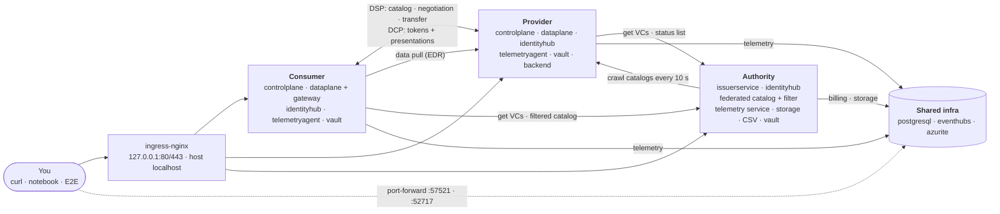

### Level 2: inside one participant (provider and consumer are identical, plus the provider backend)

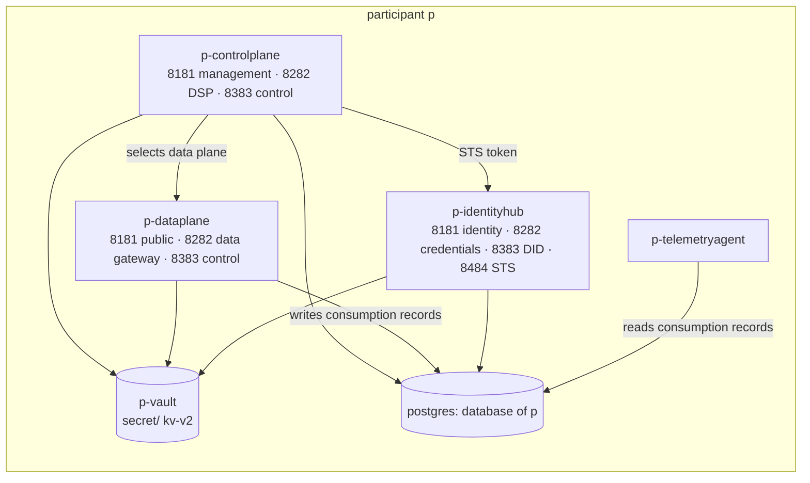

Section 3 has the full call map with ports.

The deployment has three layers:

| Layer | What lives there |
| --- | --- |
| **Trust / governance** (Authority) | Who belongs to the dataspace (issuer + credentials), what exists in it (federated catalog), and who used what (telemetry/billing) |
| **Sovereign participants** (Provider, Consumer) | One EDC connector each (control plane + data plane), one wallet (identity hub) and one Vault, all separate per participant |
| **Shared infra** | One Postgres server (one database per tenant), Azure emulators for telemetry and blob storage |

---

## 2. Actors

| Actor | Kind | Represented by | Does |
| --- | --- | --- | --- |
| **Dataspace operator** | Human | You, calling the issuer admin API | Defines credential types, registers participants, attests membership/domain/visibility |
| **Provider** (organisation) | Human + system | You via `/provider/cp/management`; `provider-*` pods | Publishes assets, policies and contract offers, serves data, can retire agreements |
| **Consumer** (organisation) | Human + system | You via `/consumer/cp/management` and `/consumer/dp/data`; `consumer-*` pods | Discovers, negotiates, transfers and consumes data |
| **Consumer application** | System | You, or any HTTP client | Reads data through the consumer data gateway with an agreement id |
| **Issuer** | System | `authority-issuerservice` | Evaluates attestations and signs Verifiable Credentials |
| **Wallet** | System | `<p>-identityhub` | Holds a participant's DID, keys (via Vault) and VCs; issues self-signed tokens (STS); presents VCs |
| **Federated catalog** | System | `authority-federatedcatalog` (+ filter) | Crawls every registered participant and serves a searchable, credential-filtered catalog |
| **Telemetry agent** | System | `<p>-telemetryagent` | Ships data-consumption records to the event broker |
| **Billing** | System | telemetry service / storage / CSV manager | Turns consumption records into monthly per-participant CSV reports |
| **Data backend** | External system | `provider-backend` | The real API behind an asset (normal, OAuth2-protected, failing) |
| **Secret store** | System | `<p>-vault` | Private keys, AES keys, STS client secrets, backend credentials |

---

## 3. Component interaction map

Every arrow is an in-cluster HTTP call between Kubernetes services in namespace `default`. Port and API context are shown on each arrow.

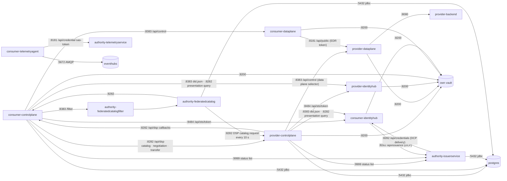

Port convention in every EDC runtime: `8080` health (`/api/check/liveness|readiness`), `8181` management/identity/public, `8282` protocol/credentials/data, `8383` control/did, `8484` STS/onboarding, `9999` status list (issuer only).

---

## 4. Trust model

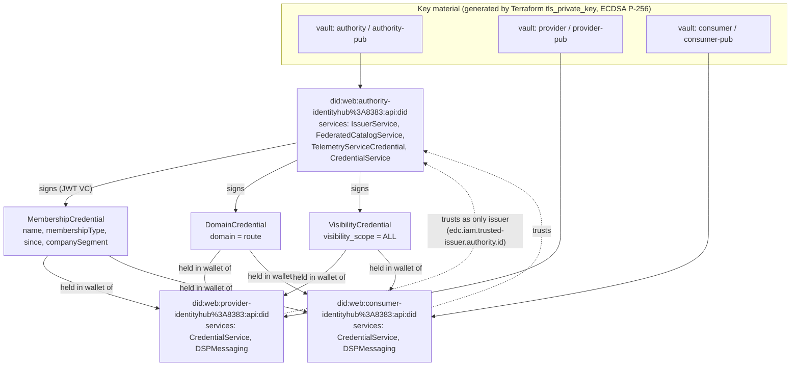

- Identity is a **did:web** DID per participant. The DID document is served by the participant's own identity hub at `http://<p>-identityhub:8383/api/did/did.json`, so it only resolves inside the cluster.
- Trust is **one level deep**: the authority is the only trusted issuer, and every policy decision is made on credentials it signed.
- The authority holds credentials too (its own Membership/Domain), because it is also crawled and queried.

---

## 5. Bootstrap: what happens on `up`

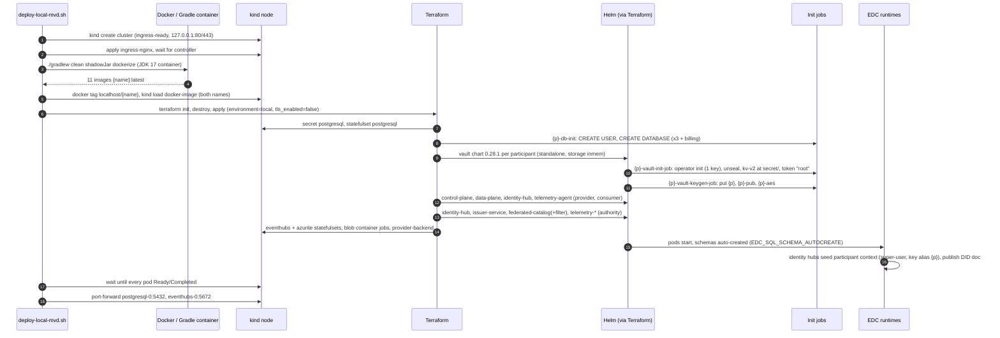

At this point nobody holds any credential yet. Until Block A runs, every policy will fail (no MembershipCredential).

---

## 6. Onboarding: credential types and participants

Flows **A1–A3**: the operator prepares the issuer.

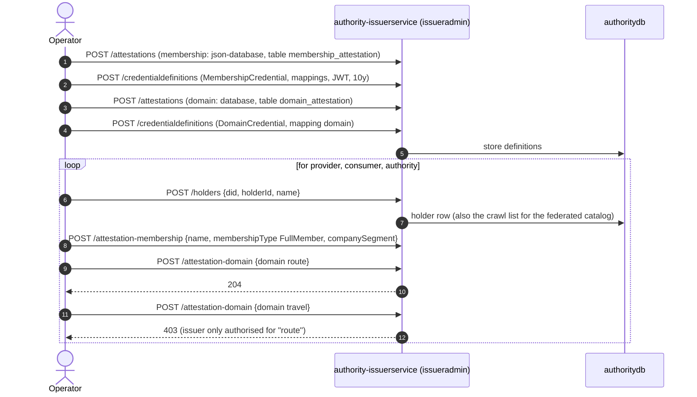

---

## 7. Credential issuance (DCP)

Flow **A4**: each participant asks its own wallet to fetch a credential from the issuer.

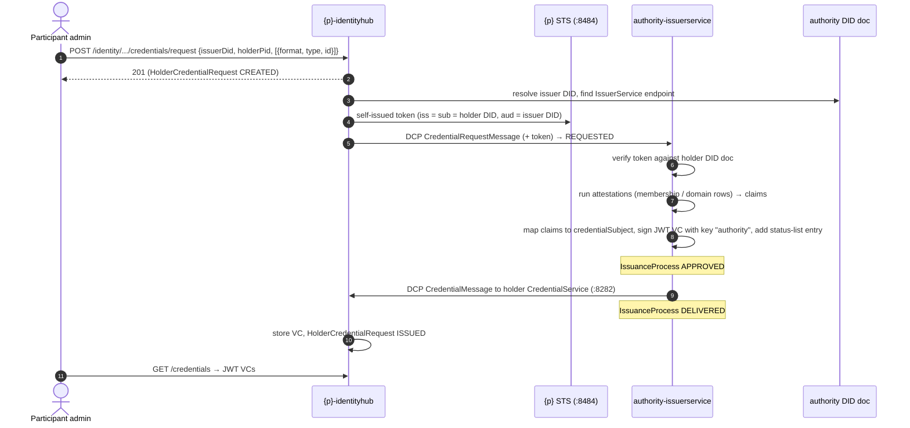

State machines involved:

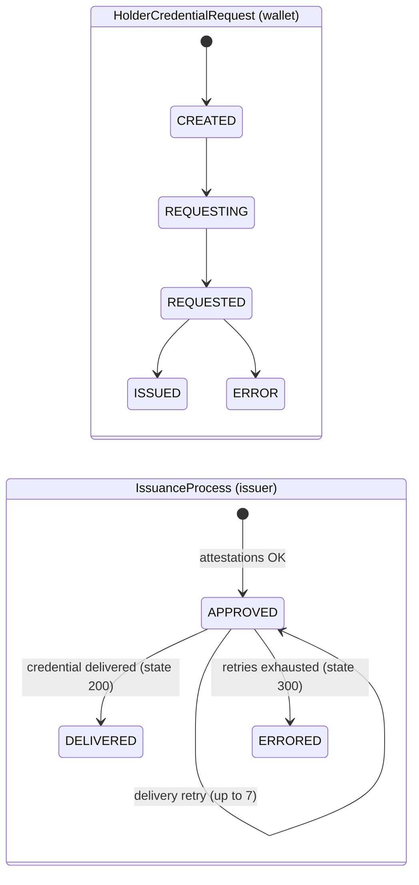

If the request descriptor uses `credentialType` instead of `type`, the issuer stays in the APPROVED→APPROVED retry loop until ERRORED, with an empty failure cause (see FLOWS.md, gotcha 1).

---

## 8. Credential presentation inside every DSP call

This runs underneath every catalog, negotiation and transfer request in Blocks C–E. It is how the provider learns *who* is asking and *which credentials* they hold.

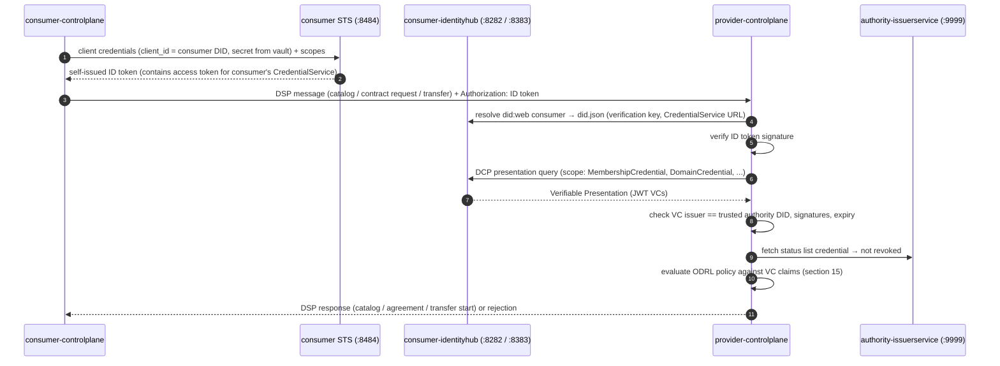

---

## 9. Publishing

Flows **B1–B7**, provider side only. Nothing leaves the provider yet.

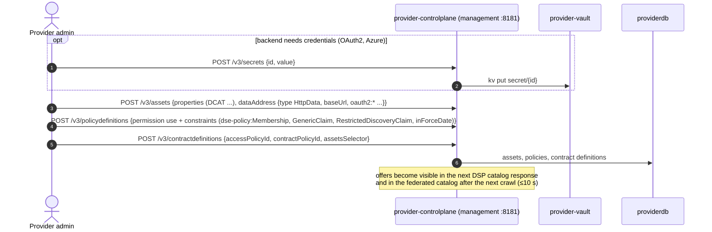

An entry is the triple asset + policy definition + contract definition:

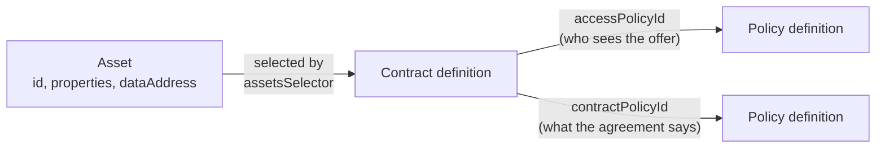

---

## 10. Discovery

### 10.1 Federated catalog crawl and credential-filtered query (C2–C6)

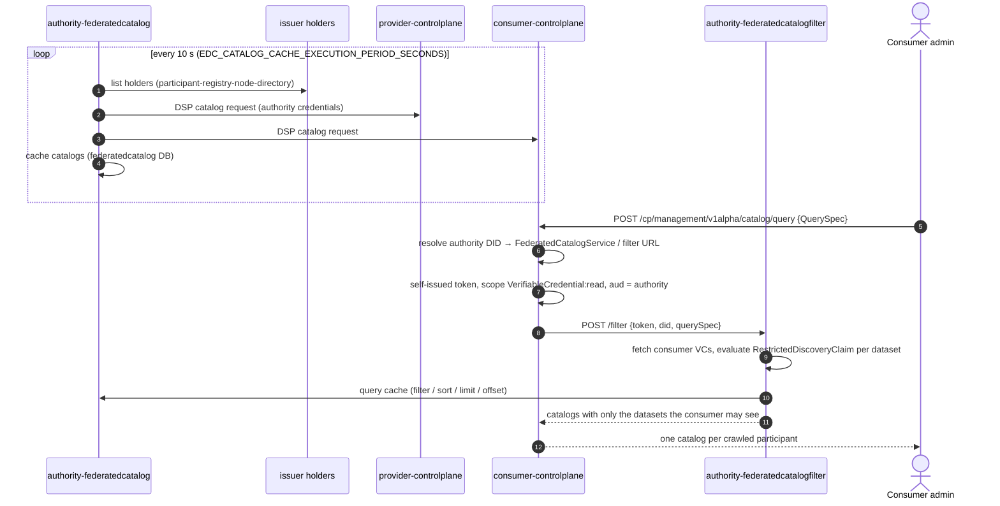

`POST /authority/catalog/v1alpha/catalog/query` (C2) skips the filter and queries the cache directly.

### 10.2 Direct DSP catalog (C1)

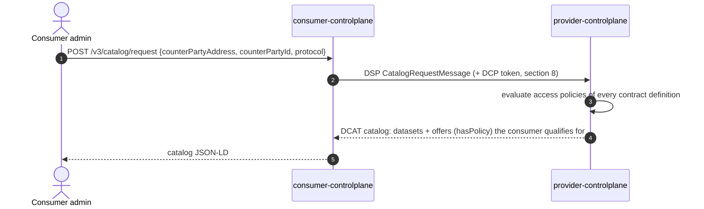

---

## 11. Contract negotiation

Flows **D1–D5**.

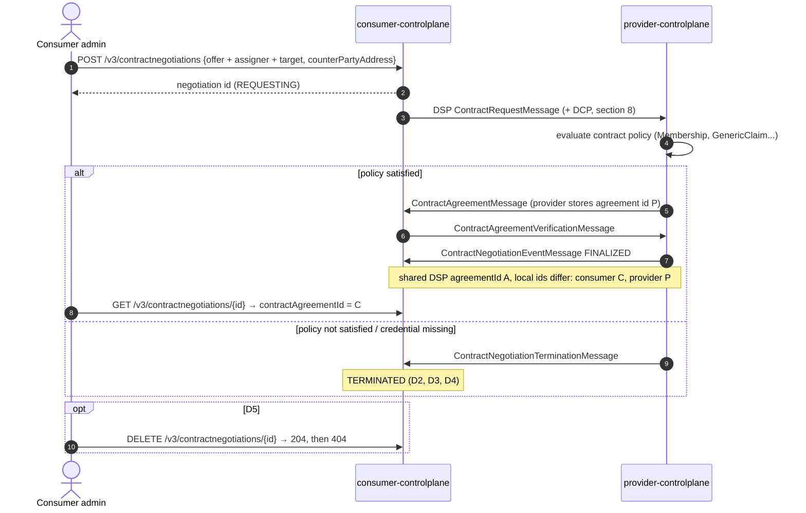

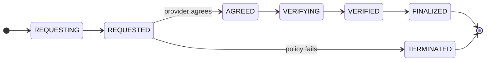

Simplified view: the provider also passes through AGREEING and FINALIZING. States are stored as numeric codes in the database (`1200` = FINALIZED, `1400` = TERMINATED).

---

## 12. Transfer and data access

### 12.1 HTTP pull through the consumer data gateway (E1–E3, E7, E9)

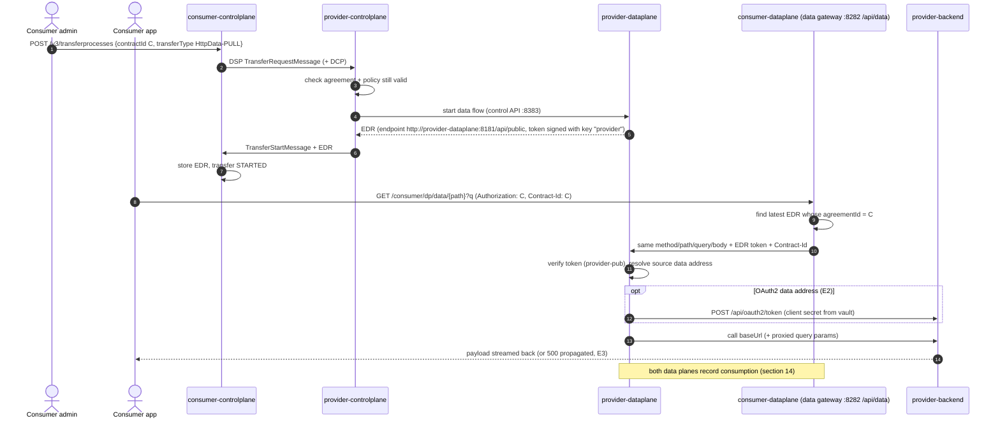

### 12.2 Push to blob storage (E4)

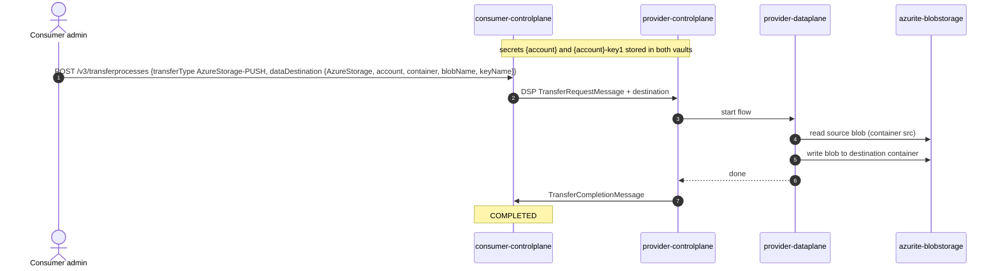

### 12.3 Transfer states

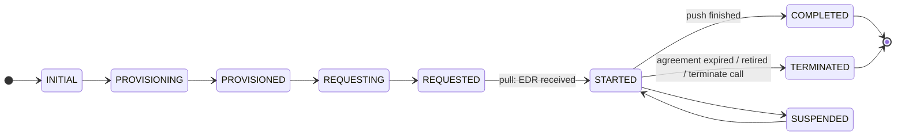

---

## 13. Agreement lifecycle: expiry, retirement, reactivation

Flows **E5** and **E6**.

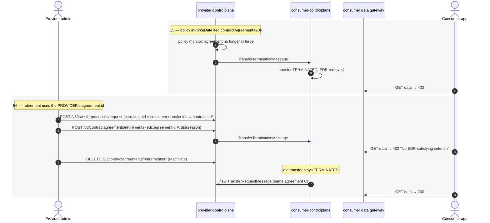

---

## 14. Telemetry and billing

Flows **F1–F7**.

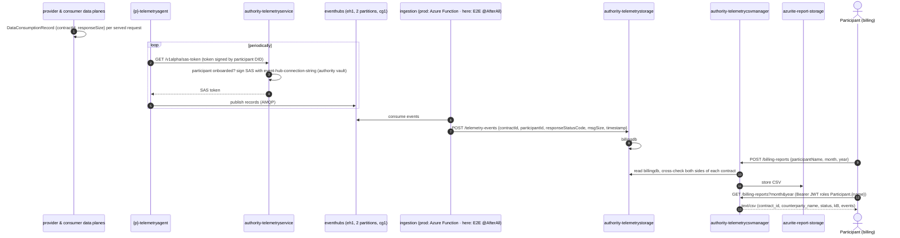

Locally, nothing plays the ingestion role (step 6) unless the E2E suite runs. The CSV manager checks the role claim but **not the JWT signature**.

---

## 15. Visible vs. negotiable: the policy decision

How the DSE policy functions decide, for one consumer and one dataset:

```mermaid
flowchart TD
    Q["Consumer asks for catalog / negotiation"] --> M{"Valid MembershipCredential<br/>from the authority?<br/>(dse-policy:Membership)"}
    M -- no --> X1["Invisible and not negotiable"]
    M -- yes --> R{"Dataset has<br/>RestrictedDiscoveryClaim?"}
    R -- no --> VIS["Visible in catalog"]
    R -- yes --> RV{"Claim matches?<br/>or VisibilityCredential scope ALL"}
    RV -- no --> X2["Hidden from catalog<br/>(C4)"]
    RV -- yes --> VIS
    VIS --> N["Contract request"]
    N --> G{"All GenericClaim /<br/>RestrictedDiscovery claims<br/>match actual VCs?"}
    G -- no --> T["TERMINATED<br/>(D2, D3, D4)"]
    G -- yes --> F{"inForceDate<br/>still valid?"}
    F -- no --> T2["Transfer TERMINATED (E5)"]
    F -- yes --> OK["FINALIZED → transfer allowed"]
```

D4 in one sentence: a VisibilityCredential lets you *see* a restricted asset, but you still need the matching DomainCredential to *contract* it.

---

## Glossary

| Term | Meaning in this environment |
| --- | --- |
| **Agreement (contract agreement)** | Result of a FINALIZED negotiation. Both sides share the DSP `agreementId`, but each stores the agreement under **its own local `@id`**. The data gateway expects the consumer's `@id`; retirement expects the provider's `@id` |
| **Asset** | A data offering registered in a control plane: properties (DCAT metadata) plus a data address saying where the data really is |
| **Attestation** | A source of facts the issuer checks before issuing a credential (membership table, domain table, visibility table) |
| **Attestation definition** | Issuer config saying where an attestation is read from (`json-database` or `database`, table, column) |
| **Authority** | The dataspace operator's set of services: issuer, authority identity hub, federated catalog, telemetry/billing |
| **Azurite** | Microsoft's local emulator for Azure Storage (blob/queue/table). Three instances here |
| **CaaS** | Connector-as-a-Service: one dedicated connector per participant, operated for them |
| **Catalog (DCAT)** | List of datasets with offers that a provider returns over DSP |
| **Contract definition** | Links assets (via `assetsSelector`) to an access policy and a contract policy |
| **Control plane** | EDC runtime that manages assets, policies, negotiations and transfer processes; speaks DSP |
| **Credential definition** | Issuer config for a credential type: attestations used, claim mappings, format (JWT), validity |
| **CredentialService** | DID-document service of a wallet where credentials are delivered (DCP storage) and presented (DCP presentation) |
| **Data address** | Where and how the provider data plane reads the data (`HttpData` + `baseUrl`, `AzureStorage` + container…) |
| **Data gateway** | DSE data-plane API on the consumer (`/consumer/dp/data`) that resolves the EDR for an agreement and proxies the request to the provider |
| **Data plane** | EDC runtime that moves the actual bytes (public API for pull, push to sinks) |
| **DataConsumptionRecord** | Per-request record (contract id, response size) written by data planes for billing |
| **DCP** | Decentralized Claims Protocol: how wallets request credentials from issuers and present them to verifiers |
| **DID / did:web** | Decentralized identifier. `did:web:host%3Aport:path` resolves to `http(s)://host:port/path/did.json` |
| **DID document** | JSON with a participant's public keys and service endpoints |
| **Domain** | DSE claim (`route`, `travel`) used for business-domain restrictions. This issuer may only attest `route` |
| **DSE** | Amadeus "Dataspace Ecosystem" extensions on top of EDC (policies, catalog filter, telemetry, retirement…) |
| **DSP** | Dataspace Protocol (version `2025-1` here): catalog, negotiation and transfer messages between connectors |
| **EDC** | Eclipse Dataspace Components: the Java framework every runtime here is built on (0.16) |
| **EDR** | Endpoint Data Reference: endpoint + short-lived token the consumer gets to pull data for one transfer |
| **Event Hubs emulator** | Microsoft's local emulator for Azure Event Hubs; the telemetry event broker here |
| **Federated catalog** | Authority service that crawls every registered participant every 10 s and caches their catalogs |
| **Federated catalog filter** | Authority service that only returns datasets the caller's credentials allow |
| **Holder** | A participant registered in the issuer; also the crawl list of the federated catalog |
| **holderPid** | Id the wallet chooses for a credential request; the issuer echoes it back on delivery |
| **Identity Hub (IH)** | Wallet runtime: DID document, key pairs (via Vault), credentials, STS |
| **inForceDate** | ODRL constraint limiting how long an agreement is valid (`contractAgreement+20s`) |
| **Issuance process** | Issuer-side record of one credential request: APPROVED → DELIVERED / ERRORED |
| **Issuer Service** | Authority runtime that evaluates attestations and signs VCs; also serves the revocation status list |
| **JSON-LD** | JSON with `@context`; every EDC management/DSP payload is JSON-LD, so namespaces matter |
| **kind** | Kubernetes-in-Docker: the local single-node cluster |
| **Management API** | Control-plane admin API (`/cp/management/v3`); no auth in this setup |
| **MembershipCredential** | VC proving dataspace membership (name, type, since, companySegment). Required by every policy |
| **MVD** | Minimum Viable Dataspace: the smallest complete dataspace (authority + provider + consumer) |
| **ODRL** | Open Digital Rights Language: policy model (permission, action `use`, constraints) |
| **Participant context** | Identity-hub tenant record per DID, seeded at boot with admin role and key alias |
| **Policy definition** | Stored ODRL policy referenced by contract definitions |
| **Policy monitor** | Control-plane loop that terminates transfers when an agreement stops being in force |
| **Presentation (VP)** | Set of VCs a wallet hands to a verifier, wrapped and signed by the holder |
| **RestrictedDiscoveryClaim** | DSE constraint that hides a dataset from the catalog unless the claim matches |
| **GenericClaim** | DSE constraint that checks any claim of any credential type with a JSON path |
| **Retirement** | DSE feature: the provider revokes an agreement without deleting it; reversible |
| **SAS token** | Azure Shared Access Signature; what telemetry agents use to publish to Event Hub |
| **Status list** | Revocation list served by the issuer (`:9999/api/statuslist`), checked when verifying VCs |
| **STS** | Secure Token Service inside each identity hub; issues the self-signed tokens used in DCP |
| **Telemetry agent** | Per-participant runtime that ships consumption records to the event broker |
| **Transfer process** | Control-plane record of one data transfer (pull or push) and its state |
| **Transfer type** | `HttpData-PULL`, `AzureStorage-PUSH`… |
| **Vault** | HashiCorp Vault, one per participant, KV v2 at `secret/`, root token `root`, in-memory storage |
| **VC** | Verifiable Credential: signed claims (JWT format here) about a holder |
| **VisibilityCredential** | DSE VC (`visibility_scope = ALL`) that widens catalog visibility without granting access |
