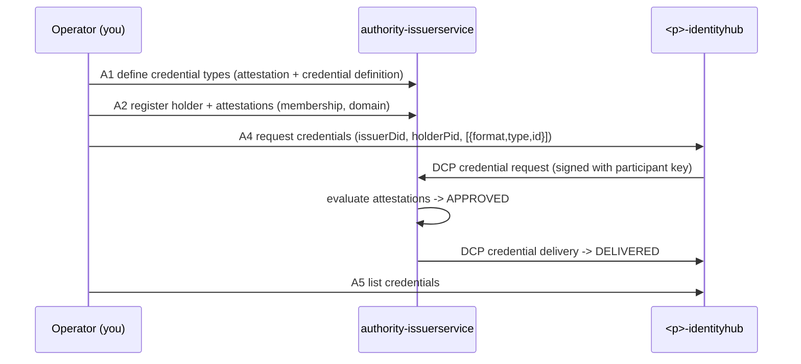
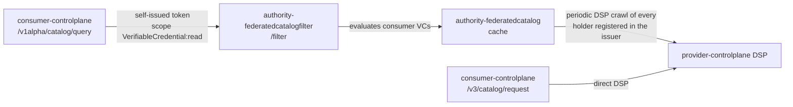
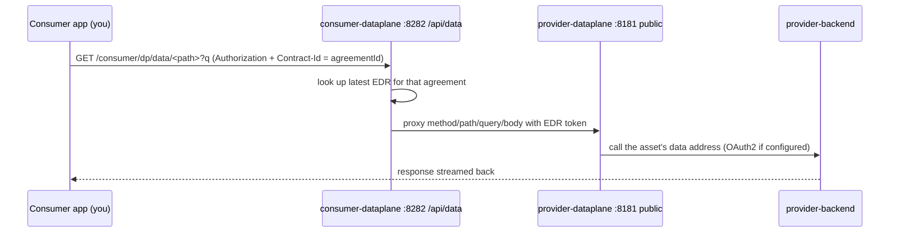
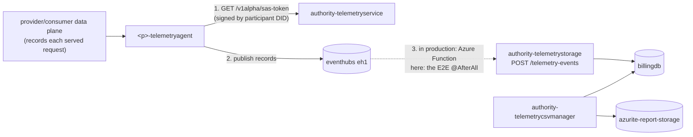

# Flows available in the local MVD

Everything you can do with the environment brought up by `deploy-local-mvd.sh`, grouped into blocks. Each flow lists who takes part, the calls involved, the expected result, and where it was proven:

- **E2E**: covered by the upstream suite `LocalEndToEndTests` (`system-tests/runner`). The full suite (34 tests) passed against this environment on 2026-10-09 in 7.5 min.
- **curl**: also run by hand with the commands below, through the ingress on `http://localhost`.
- **code**: exposed by the code (controller found in `extensions/`) but not exercised by the tests or by hand.

See [README.md](README.md) for the architecture, ports and ingress routes.

---

## 0. Conventions used below

```bash
B=http://localhost                                    # ingress, Host must be "localhost"
did() { echo "did:web:$1-identityhub%3A8383:api:did"; }
ctx() { printf '%s' "$(did "$1")" | base64 | tr '+/' '-_' | tr -d '\n'; }   # participant context id in URLs
DSP() { echo "http://$1-controlplane:8282/api/dsp/2025-1"; }                # in-cluster DSP address
```

| Thing | Value |
| --- | --- |
| Participants | `authority`, `provider`, `consumer` (`<p>` below) |
| DIDs | `did:web:<p>-identityhub%3A8383:api:did` |
| Participant context id in IH/Issuer URLs | base64url of the DID (with `=` padding) |
| Management API | `$B/<p>/cp/management/v3/...` |
| DSP protocol id | `dataspace-protocol-http:2025-1` |
| Vault token | `root` (`X-Vault-Token: root`) |
| Auth on management / identity / issuer admin APIs | none |

**Gotchas found while running these by hand.** Each one cost a failed attempt:

1. A credential request descriptor uses **`type`**, not `credentialType`. With the wrong name the issuer still *approves* the request (it finds the definition by `id`), but delivery fails silently. The log shows `failed to Deliver Credentials. Cause:` with an empty cause, and the process ends in state 300 (ERRORED).
2. A contract request must use the Management API JSON-LD context (`https://w3id.org/edc/connector/management/v0.0.1`) plus `dse-policy`. With only `@vocab` EDC, `Offer`/`assigner`/`target` resolve to the wrong namespace and you get a 400.
3. The consumer data gateway needs **both** `Authorization: <agreementId>` and `Contract-Id: <agreementId>`. Without `Contract-Id` it returns an HTML 500.
4. **Agreement ids differ per side.** Both sides share the DSP-level `agreementId`, but each stores the agreement under its own local `@id`. The consumer data gateway and `contractNegotiation.contractAgreementId` use the consumer's local `@id`. Retirement uses the provider's local `@id`, which you find via the provider's transfer process whose `correlationId` is the consumer's transfer process id (or by querying the provider's agreements for the shared `agreementId`).
5. The federated catalog is a cache: new assets show up after the next crawl (seconds), not immediately.
6. The authority's direct catalog query (C2) needs a JSON-LD QuerySpec with `@context`. A bare `{}` returns `[{"message":"Failed to expand JsonObject…"}]`, which looks like a one-item list if you only count results. The participant-side query (C3) accepts `{}`.

---

## Block A — Identity, trust and onboarding

Actors: Authority (Issuer Service, Authority Identity Hub), each participant's Identity Hub (wallet).



| # | Flow | Calls | Result | Proven |
| --- | --- | --- | --- | --- |
| A1 | **Define a credential type** (Membership, Domain, Visibility) | `POST $B/authority/is/issueradmin/v1alpha/participants/$(ctx authority)/attestations` then `.../credentialdefinitions` | 201. Definitions `membership-credential-def-1`, `domain-credential-def-1`, `visibility-credential-def-1` | E2E, curl |
| A2 | **Register a participant** (holder + membership attestation + domain attestation) | `.../holders`, `.../attestation-membership`, `.../attestation-domain` | 201 / 204. The holder is also what the federated catalog crawls (B/C) | E2E, curl |
| A3 | **Domain restriction**: this issuer can only attest domain `route` (`domain: "route"` in Terraform) | `POST .../attestation-domain {"holderId":…, "domain":"travel"}` | **403** for `travel`, 204 for `route` | E2E, curl |
| A4 | **Request credentials** (DCP issuance) | `POST $B/<p>/ih/identity/v1alpha/participants/$(ctx <p>)/credentials/request` | 201, then the issuance process goes APPROVED → DELIVERED in about 1 s | E2E, curl |
| A5 | **List a wallet's credentials** | `GET $B/<p>/ih/identity/v1alpha/participants/$(ctx <p>)/credentials` | JWT VCs with `type`, `credentialSubject` (`name`, `membership`, `companySegment`, `domain`, `visibility_scope`) | E2E, curl |
| A6 | **Visibility credential** (`VisibilityCredential`, scope `ALL`) | A1 for visibility, then `POST .../attestation-visibility {"id":did,"holderId":did,"visibility_scope":"ALL"}`, then A4 | The holder can *see* restricted-discovery assets (see C4/D4) | E2E |
| A7 | **Update / delete / query attestations** | `PUT`, `DELETE /{id}`, `POST /request` on `attestation-membership`, `attestation-domain`, `attestation-visibility` | — | code |
| A8 | **Inspect issuance** | `POST $B/authority/is/issueradmin/v1alpha/participants/$(ctx authority)/issuanceprocesses/query` with `{}` | State per process (`APPROVED`, `DELIVERED`, errors) with the computed claims | curl |
| A9 | **Resolve a DID document** | `GET $B/<p>/ih/did/did.json` | Verification key plus services. Authority: IssuerService, FederatedCatalogService, TelemetryServiceCredential, CredentialService. Participants: CredentialService, DSPMessaging | curl |
| A10 | **List participant contexts** (seeded at boot) | `GET $B/<p>/ih/identity/v1alpha/participants/$(ctx <p>)` | State 200 (ACTIVATED), `roles: ["admin"]` | curl |

<details><summary>Commands (A1–A5), as run</summary>

```bash
AD=$(did authority); IS="$B/authority/is/issueradmin/v1alpha/participants/$(ctx authority)"
J='Content-Type: application/json'

# A1
curl -X POST -H "$J" "$IS/attestations" -d '{"id":"membership-attestation-def-1","attestationType":"json-database",
  "configuration":{"dataSourceName":"membership","tableName":"membership_attestation","propertiesColumn":"properties"}}'
curl -X POST -H "$J" "$IS/credentialdefinitions" -d '{"id":"membership-credential-def-1","credentialType":"MembershipCredential",
  "attestations":["membership-attestation-def-1"],"format":"VC1_0_JWT","validity":315360000,
  "jsonSchemaUrl":"https://example.com/schema/membership-credential.json","mappings":[
   {"input":"name","output":"credentialSubject.name","required":true},
   {"input":"membership_type","output":"credentialSubject.membership.membershipType","required":true},
   {"input":"membership_start_date","output":"credentialSubject.membership.since","required":true},
   {"input":"companySegment","output":"credentialSubject.companySegment","required":false}]}'
curl -X POST -H "$J" "$IS/attestations" -d '{"id":"domain-attestation-def-1","attestationType":"database",
  "configuration":{"dataSourceName":"domain","tableName":"domain_attestation"}}'
curl -X POST -H "$J" "$IS/credentialdefinitions" -d '{"id":"domain-credential-def-1","credentialType":"DomainCredential",
  "attestations":["domain-attestation-def-1"],"format":"VC1_0_JWT","validity":315360000,
  "jsonSchemaUrl":"https://example.com/schema/domain-credential.json",
  "mappings":[{"input":"domain","output":"credentialSubject.domain","required":true}]}'

# A2 + A3 (repeat for provider, consumer, authority)
D=$(did consumer)
curl -X POST -H "$J" "$IS/holders" -d "{\"did\":\"$D\",\"holderId\":\"$D\",\"name\":\"consumer\",\"properties\":{}}"
curl -X POST -H "$J" "$IS/attestation-membership" -d "{\"id\":\"$D\",\"name\":\"consumer\",\"holderId\":\"$D\",
  \"membershipType\":\"FullMember\",\"properties\":{\"companySegment\":\"Airlines\"}}"
curl -X POST -H "$J" "$IS/attestation-domain" -d "{\"holderId\":\"$D\",\"domain\":\"route\"}"     # 204
curl -X POST -H "$J" "$IS/attestation-domain" -d "{\"holderId\":\"$D\",\"domain\":\"travel\"}"    # 403

# A4 — note "type", not "credentialType"
curl -X POST -H "$J" "$B/consumer/ih/identity/v1alpha/participants/$(ctx consumer)/credentials/request" \
  -d "{\"issuerDid\":\"$AD\",\"holderPid\":\"${D}MembershipCredential\",
       \"credentials\":[{\"format\":\"VC1_0_JWT\",\"type\":\"MembershipCredential\",\"id\":\"membership-credential-def-1\"}]}"

# A5
curl "$B/consumer/ih/identity/v1alpha/participants/$(ctx consumer)/credentials"
```
</details>

---

## Block B — Publishing (provider)

Actor: provider control plane (Management API). Every asset becomes an *entry* made of an asset, a policy definition and a contract definition.

| # | Flow | Calls | Result | Proven |
| --- | --- | --- | --- | --- |
| B1 | **Create an HTTP asset** (`HttpData`, backend URL, `proxyQueryParams`) | `POST $B/provider/cp/management/v3/assets` | Asset id | E2E |
| B2 | **Asset with a custom JSON-LD context / DCAT metadata** (`dct:identifier`, `dct:publisher`, `dct:type`, nested `dcat:theme`) | same, with `@context` adding `dct`/`dcat` | Searchable in the federated catalog (C2) | E2E |
| B3 | **Raw asset with nested arrays** (`dcat:themeTaxonomy` → `skos:hasTopConcept` → `skos:narrower`) | same, full JSON-LD body | Selectable by contract definitions on nested paths (B7) | E2E |
| B4 | **Store a secret in the participant Vault** (OAuth2 client secret, Azure key) | `POST $B/<p>/cp/management/v3/secrets {"@id":key,"@type":"Secret","value":…}` | 200. Also possible directly via Vault, see G1 | E2E |
| B5 | **OAuth2-protected backend** (`oauth2:clientId`, `oauth2:clientSecretKey`, `oauth2:tokenUrl` in the data address) | B4 + B1 | The provider data plane fetches a token before calling the backend | E2E |
| B6 | **Policy definition** with DSE constraints | `POST .../v3/policydefinitions` | Policy id (catalogue of constraints below) | E2E |
| B7 | **Contract definition**, by asset id or by selector on (nested) properties, single or AND-combined | `POST .../v3/contractdefinitions` with `assetsSelector` | Offers appear in the catalog for matching assets | E2E |
| B8 | **Query / get / delete** assets, policies, contract definitions | `POST .../request`, `GET /{id}`, `DELETE /{id}` | Standard EDC Management API v3 | code, curl (query) |

**Policy constraints available** (`dse-policy` prefix = `https://w3id.org/dse/policy/`):

| leftOperand | Meaning | Example used |
| --- | --- | --- |
| `dse-policy:Membership` | Holder has an active MembershipCredential. Always added to every entry | `eq active` |
| `dse-policy:GenericClaim.$.<CredentialType>.<path>` | JSON-path match on any credential claim (access) | `GenericClaim.$.MembershipCredential.name eq consumer`, `GenericClaim.$.DomainCredential.domain eq route` |
| `dse-policy:RestrictedDiscoveryClaim.$.<CredentialType>.<path>` | Same, but also **hides** the asset from the catalog for those who don't match | `RestrictedDiscoveryClaim.$.DomainCredential.domain eq travel` |
| `inForceDate` | Agreement validity window | `lteq contractAgreement+20s` |

**Assets seeded by the E2E suite** (provider), handy for trying the other blocks:

| Asset id | What it demonstrates |
| --- | --- |
| `rest-api` | Basic HTTP pull, access limited to `name = consumer` |
| `rest-api-domain` | Access requires DomainCredential `route` |
| `rest-api-oauth2` | Backend behind OAuth2 client credentials |
| `rest-api-embedded-query-params` | Query params fixed in the data address |
| `rest-api-20s` | Agreement expires 20 s after signing |
| `failure-rest-api` | Backend returns 500 |
| `restricted-api` | Policy nobody can satisfy (`name = unknown`) |
| `rest-api-route-domain-restricted` | Restricted discovery, domain `route` |
| `rest-api-travel-domain-restricted` | Restricted discovery, domain `travel` (nobody can hold it) |
| `azure-blob-storage` | Source blob in Azurite for push transfers |
| `dcat-asset-alpha/beta/gamma` | DCAT metadata for filter/sort/pagination |
| `urn:…:order-created-event[:versions:1.0.0]` | Nested-array selectors |

---

## Block C — Discovery



| # | Flow | Calls | Result | Proven |
| --- | --- | --- | --- | --- |
| C1 | **Direct DSP catalog** (consumer asks the provider) | `POST $B/consumer/cp/management/v3/catalog/request` with `counterPartyAddress=$(DSP provider)`, `counterPartyId=$(did provider)`, `protocol` | DCAT catalog with offers (`hasPolicy`) per dataset | curl |
| C2 | **Federated catalog, direct** (no credential filter) with `filterExpression`, `sortField`/`sortOrder`, `limit`/`offset`, operators `=`, `like`, `in`, nested paths `properties.'<iri>'.'<iri>'` | `POST $B/authority/catalog/v1alpha/catalog/query` with a JSON-LD QuerySpec, e.g. `{"@context":{"@vocab":"https://w3id.org/edc/v0.0.1/ns/"},"@type":"QuerySpec","limit":500}`. A bare `{}` returns an error array | 12 tests: by publisher, type, identifier (exact/like), theme, sub-theme, AND, ASC/DESC, page 1/2, offset beyond results | E2E, curl |
| C3 | **Credential-filtered federated catalog** (what a participant is allowed to see) | `POST $B/<p>/cp/management/v1alpha/catalog/query` with `{}` or a QuerySpec | One catalog per crawled participant; the consumer gets the provider's datasets it may see, and an empty one for itself | E2E, curl |
| C4 | **Restricted discovery**: `route` asset visible, `travel` asset hidden | C3 as consumer | `rest-api-route-domain-restricted` present, `rest-api-travel-domain-restricted` absent | E2E |
| C5 | **Visibility credential widens discovery** | A6, then C3 | The `travel` asset becomes visible | E2E |
| C6 | **Provider's own catalog via the authority** | C3 as provider | All 15 provider datasets, each with `createdAt` | E2E |

---

## Block D — Contract negotiation

| # | Flow | Calls | Result | Proven |
| --- | --- | --- | --- | --- |
| D1 | **Negotiate an offer** | `POST $B/consumer/cp/management/v3/contractnegotiations` (offer from C1 + `assigner` + `target`), poll `GET .../{id}/state`, read `contractAgreementId` | `FINALIZED` in a few seconds | E2E, curl |
| D2 | **Policy not satisfiable** (`restricted-api`) | D1 | `TERMINATED` | E2E |
| D3 | **Missing credential** (`rest-api-travel-domain-restricted`, no travel DomainCredential) | D1 | `TERMINATED` | E2E |
| D4 | **Visible but not negotiable**: with VisibilityCredential `ALL` the consumer *sees* the travel asset, but access still requires the domain claim | A6 + C3 + D1 | Visible in the catalog, negotiation `TERMINATED`. Visibility ≠ access | E2E |
| D5 | **Delete a negotiation** | `DELETE .../v3/contractnegotiations/{id}` | 204, then GET → 404 | E2E |
| D6 | **Query negotiations / agreements** | `POST .../v3/contractnegotiations/request`, `.../v3/contractagreements/request` | Standard EDC | code |

<details><summary>Commands (C1 → D1), as run</summary>

```bash
J='Content-Type: application/json'
curl -s -X POST -H "$J" "$B/consumer/cp/management/v3/catalog/request" -d "{
  \"@context\":{\"@vocab\":\"https://w3id.org/edc/v0.0.1/ns/\"},\"@type\":\"CatalogRequest\",
  \"counterPartyAddress\":\"$(DSP provider)\",\"counterPartyId\":\"$(did provider)\",
  \"protocol\":\"dataspace-protocol-http:2025-1\",\"querySpec\":{\"limit\":50}}" > catalog.json

OFFER=$(jq -c '.dataset|(if type=="array" then . else [.] end)|map(select(.["@id"]=="rest-api"))[0].hasPolicy|(if type=="array" then .[0] else . end)' catalog.json)
BODY=$(jq -n --argjson p "$OFFER" --arg a "$(DSP provider)" --arg pid "$(did provider)" '{
  "@context":["https://w3id.org/edc/connector/management/v0.0.1",{"dse-policy":"https://w3id.org/dse/policy/"}],
  "@type":"ContractRequest","counterPartyAddress":$a,"protocol":"dataspace-protocol-http:2025-1",
  "policy":($p + {"assigner":$pid,"target":"rest-api"})}')
NEG=$(curl -s -X POST -H "$J" "$B/consumer/cp/management/v3/contractnegotiations" -d "$BODY" | jq -r '.["@id"]')
until [ "$(curl -s $B/consumer/cp/management/v3/contractnegotiations/$NEG/state | jq -r .state)" = FINALIZED ]; do sleep 1; done
AGR=$(curl -s "$B/consumer/cp/management/v3/contractnegotiations/$NEG" | jq -r .contractAgreementId)
```
</details>

---

## Block E — Transfer and data access



| # | Flow | Calls | Result | Proven |
| --- | --- | --- | --- | --- |
| E1 | **HTTP pull** (`HttpData-PULL`) via the consumer data gateway | `POST $B/consumer/cp/management/v3/transferprocesses` (`contractId`, `transferType`), wait for `STARTED`, then `GET $B/consumer/dp/data?message=…` with `Authorization` + `Contract-Id` | Backend payload, e.g. `{"message":"hola-desde-ging"}` | E2E, curl |
| E2 | Pull variants: domain-gated, **OAuth2 backend**, **embedded query params** | E1 on `rest-api-domain`, `rest-api-oauth2`, `rest-api-embedded-query-params` | Same payload; OAuth2 is transparent to the consumer | E2E |
| E3 | **Backend failure propagated** (`failure-rest-api`) | E1 | 500 with `Received code transferring HTTP data: 500 - Server Error.` | E2E |
| E4 | **Push to blob storage** (`AzureStorage-PUSH`, Azurite) | Secrets in both Vaults (B4), then transfer with a `dataDestination` of type `AzureStorage` | `COMPLETED`; the blob is copied from the source container to the destination container | E2E |
| E5 | **Agreement expiry** (`rest-api-20s`, `inForceDate`) | E1 | Data OK, then after about 20 s the transfer is `TERMINATED` and data returns 403 | E2E |
| E6 | **Retire / reactivate an agreement** (provider side) | `POST $B/provider/cp/management/v3/contractagreements/retirements {"edc:agreementId":<provider id>,"dse:reason":…}`; list with `.../retirements/request`; reactivate with `DELETE .../retirements/{id}` | After retiring, the consumer transfer goes `TERMINATED` and data returns **403** `No EDR satisfying criterion`. After reactivating, **a new transfer is needed** (E1) and data returns 200 | E2E, curl |
| E7 | **Nested-array asset selectors** | E1 on the `order-created-event` assets | Transfer works only when every selector matches | E2E |
| E8 | **Terminate a transfer / query transfers** | `POST .../v3/transferprocesses/{id}/terminate`, `POST .../v3/transferprocesses/request` (e.g. filter `correlationId`) | Standard EDC | curl (query) |
| E9 | **Other HTTP methods through the gateway** (`POST`/`PUT`/`DELETE`/`PATCH`/`HEAD`, path and body forwarded) | as E1 | Forwarded to the backend (`proxyMethod/Path/Body=true`) | code |

<details><summary>Commands (E1 + E6), as run</summary>

```bash
TP=$(curl -s -X POST -H "$J" "$B/consumer/cp/management/v3/transferprocesses" -d "{
  \"@context\":{\"@vocab\":\"https://w3id.org/edc/v0.0.1/ns/\"},\"@type\":\"TransferRequest\",
  \"counterPartyAddress\":\"$(DSP provider)\",\"protocol\":\"dataspace-protocol-http:2025-1\",
  \"connectorId\":\"$(did provider)\",\"contractId\":\"$AGR\",\"transferType\":\"HttpData-PULL\"}" | jq -r '.["@id"]')
until [ "$(curl -s $B/consumer/cp/management/v3/transferprocesses/$TP/state | jq -r .state)" = STARTED ]; do sleep 1; done
curl -H "Authorization: $AGR" -H "Contract-Id: $AGR" "$B/consumer/dp/data?message=hola"     # {"message":"hola"}

# E6 — the provider's agreement id is different: find it through correlationId
PAGR=$(curl -s -X POST -H "$J" "$B/provider/cp/management/v3/transferprocesses/request" -d "{
  \"@context\":{\"@vocab\":\"https://w3id.org/edc/v0.0.1/ns/\"},\"@type\":\"QuerySpec\",
  \"filterExpression\":[{\"operandLeft\":\"correlationId\",\"operator\":\"=\",\"operandRight\":\"$TP\"}]}" | jq -r '.[0].contractId')
curl -X POST -H "$J" "$B/provider/cp/management/v3/contractagreements/retirements" -d "{
  \"@context\":{\"dse\":\"https://w3id.org/dse/v0.0.1/ns/\",\"edc\":\"https://w3id.org/edc/v0.0.1/ns/\"},
  \"edc:agreementId\":\"$PAGR\",\"dse:reason\":\"demo\"}"                                     # 204
curl -H "Authorization: $AGR" -H "Contract-Id: $AGR" "$B/consumer/dp/data?message=x"        # 403
curl -X DELETE "$B/provider/cp/management/v3/contractagreements/retirements/$PAGR"           # 204, then repeat E1
```
</details>

---

## Block F — Telemetry and billing



| # | Flow | Calls | Result | Proven |
| --- | --- | --- | --- | --- |
| F1 | **Data consumption is recorded** on both sides of every transfer and published to Event Hub by the telemetry agents | automatic after E1 | Events on Event Hub `eh1` (namespace `local-eventhub-eventhubs`), reachable at `localhost:52717` | E2E (`@AfterAll` consumes them) |
| F2 | **SAS token for the telemetry agent** | `GET /api/credential/v1alpha/sas-token` on `authority-telemetryservice` (ingress `/authority/ts/credential/...`), with a token signed by the participant DID | SAS token for Event Hub, only if the participant is onboarded | code (used internally by the agents) |
| F3 | **Ingest telemetry events** | `POST $B/authority/telemetry-events` with `{id, contractId, participantId, responseStatusCode, msgSize, csvId, timestamp}` | 201, stored in `billingdb` | E2E |
| F4 | **Generate a monthly CSV report** | `POST $B/authority/billing-reports {"participantName":"consumer","month":9,"year":2025}` | 201 | E2E |
| F5 | **Download a report** | `GET $B/authority/billing-reports?month=9&year=2025` with `Authorization: Bearer <JWT roles:["Participant.consumer"]>` | `text/csv`: `contract_id,counterparty_name,data_transfer_response_status,total_transfer_size_in_kB,total_number_of_events` | E2E, curl |
| F6 | Report with **only one side** reporting | F3 with only the consumer event | Counterparty shown as `N/A` | E2E |
| F7 | **Unknown participant / missing report** | F5 with role `Participant.doesnotexist` / a month with no report | 403 / 404 | E2E |

Without the E2E suite, nothing moves events from Event Hub into telemetry storage in this environment: F1 → F3 is manual. In production an Azure Function does it (upstream `docs/billing/index.md`).

**F5 security note (verified):** the CSV manager **does not verify the JWT signature**. A token with `{"roles":["Participant.consumer"]}` and a garbage signature also returned 200 with the consumer's report.

---

## Block G — Operations and inspection

| # | Flow | How | Proven |
| --- | --- | --- | --- |
| G1 | **Read / write Vault secrets** | `curl -H 'X-Vault-Token: root' $B/<p>/vault/v1/secret/metadata?list=true`, `.../v1/secret/data/<key>`. Each Vault holds `<p>` (private key), `<p>-pub`, `<p>-aes`, `<did>-apikey`, `<did>-sts-client-secret` | curl |
| G2 | **Query the databases** | `kubectl exec postgresql-0 -- psql -U postgres -d <authoritydb\|providerdb\|consumerdb\|billingdb>`, or `localhost:57521` while the port-forward runs. Useful tables: `edc_issuance_process`, `keypair_resource`, `participant_context` | curl |
| G3 | **Follow a flow in the logs** | `kubectl logs -f deploy/consumer-controlplane` (negotiation), `deploy/provider-dataplane` (transfer), `deploy/authority-issuerservice` (issuance), `deploy/authority-telemetryservice` | — |
| G4 | **Run the full E2E suite** | `JAVA_HOME=<JDK 17> TLS_ENABLED=false ./gradlew :system-tests:runner:test -DincludeTags=EndToEndTest -Dtls.enabled=false` from `~/deploytour-local/dataspace-ecosystem` (port-forwards must be up). **Once per deployment**: reset with `down` + `up` | done |
| G5 | **Status by participant** | `./deploy-local-mvd.sh status` | done |
| G6 | **Reset everything** | `./deploy-local-mvd.sh down && ./deploy-local-mvd.sh up` | done |

---

## Block H — Not available in this environment

| Flow | Why |
| --- | --- |
| Kafka stream transfers (`kafka-proxy-*`) | Not deployed by this Terraform version and not covered by the current suite (they were in older revisions, see `MVD-DeployTour-Local.md`) |
| Onboarding portal, Keycloak login | Not part of the MVD; onboarding is done through the issuer admin API (Block A) |
| Participant UI | Optional, outside the cluster (`START_UI=true`, provider/consumer only) |
| Connectors in another cluster/machine | DIDs and DSP addresses are in-cluster names (see README, "How the participants talk to each other") |
| TLS flows | Possible with `TLS_ENABLED=true`, but not used in this setup |
