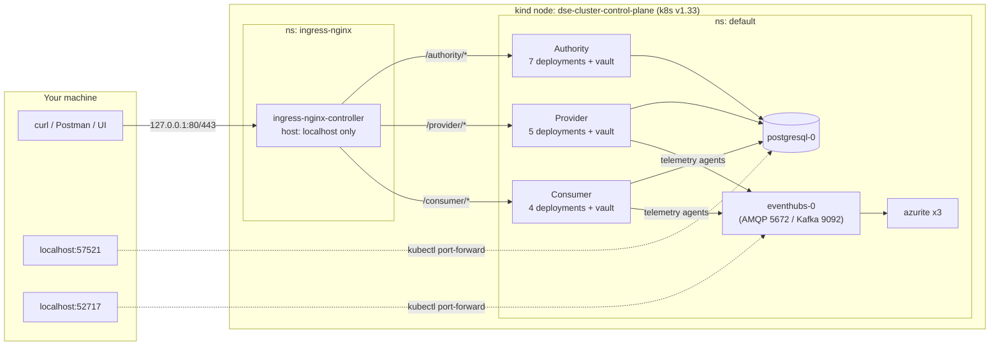
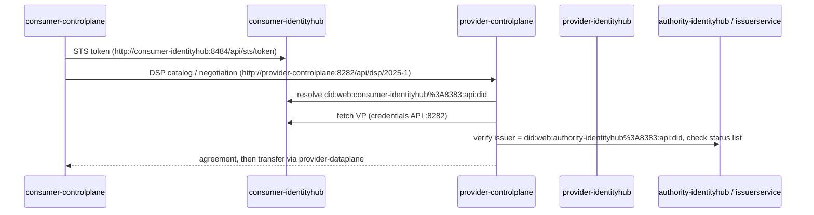

# ging_deploy — local MVD on kind

Brings up the full DEPLOYTOUR / Eona-X **Minimum Viable Dataspace** (Authority, Provider, Consumer and shared infra) on a single-node kind cluster, using the upstream [`AmadeusITGroup/dataspace-ecosystem`](https://github.com/AmadeusITGroup/dataspace-ecosystem) Terraform. This README describes the Kubernetes architecture that actually gets deployed. Everything here was checked against a live cluster (see [Verified on](#verified-on)).

```bash
cd ging_deploy
source ./rc.sh
./deploy-local-mvd.sh up       # ~20 min the first time (15 min is the Gradle build)
./deploy-local-mvd.sh status   # pods grouped by authority / provider / consumer / shared infra
./deploy-local-mvd.sh down     # terraform destroy + delete the kind cluster
```

What you can do once it's up (onboarding, publishing, catalog, negotiation, transfers, billing) is listed in [FLOWS.md](FLOWS.md). To run it all step by step: `cd tutorial && ./run.sh` opens the [tutorial notebooks](tutorial/README.md) (one per block, 00–07, plus the `08_explorer` playground) in JupyterLab. Every API is also in the [Postman collection](postman/README.md). Diagrams and glossary are in [DIAGRAMS.md](DIAGRAMS.md); the technology deep dive is [DEPLOYMENT-REPORT.md](DEPLOYMENT-REPORT.md).

Host requirements: Docker, kind, kubectl, Terraform, git. No host JDK is needed: Gradle runs inside `eclipse-temurin:17-jdk`. A host JDK is only needed for `RUN_E2E_TESTS=true`.

---

## Short answers

| Question | Answer |
| --- | --- |
| Is there an ingress? | Yes. **ingress-nginx** (kind provider manifest), reached on the host at `:80` / `:443`. 16 Ingress objects, all on **one hostname, `localhost`**, routed by path prefix (`/authority/…`, `/provider/…`, `/consumer/…`). |
| Does it work with nip.io? | **Not out of the box.** `127.0.0.1.nip.io` resolves fine, but every Ingress rule has `host: localhost`, so nginx returns **404** for any other `Host` header. See [nip.io](#nipio) for what it takes. |
| Do the connectors talk through the ingress? | **No.** DSP, DCP/STS and DID resolution all use in-cluster service names (`http://provider-controlplane:8282/api/dsp/2025-1`, `did:web:provider-identityhub%3A8383:api:did`). The ingress is only for clients outside the cluster (you, Postman, the UI, the E2E tests). |
| Namespaces? | Everything runs in **`default`**. There is no per-participant namespace isolation (unlike the target architecture in `Architecture/kubernetes-namespaces.md`). |
| TLS? | Off by default here (`TLS_ENABLED=false`). With TLS on, Terraform creates an internal CA and a wildcard cert for `*.default.svc.cluster.local` plus `localhost`, used for both pod-to-pod traffic and ingress termination. |
| Auth on the APIs? | **None** at the ingress. Management, Identity and Vault APIs all answer unauthenticated (see [Security notes](#security-notes)). |

---

## Overview



| Host port | Bound to | Goes to |
| --- | --- | --- |
| 80, 443 | `KIND_LISTEN_ADDRESS` (default `127.0.0.1`) | ingress-nginx in the kind node |
| 6443 (random host port) | 127.0.0.1 | Kubernetes API (context `kind-dse-cluster`) |
| 57521 | 127.0.0.1 | `postgresql-0:5432` (port-forward started by the script) |
| 52717 | 127.0.0.1 | `eventhubs-0:5672` (port-forward started by the script) |

Ports 52717 and 57521 are the values hardcoded in the E2E tests.

---

## Namespaces

| Namespace | Content |
| --- | --- |
| `default` | The whole dataspace: 3 participants, shared infra, init jobs |
| `ingress-nginx` | ingress-nginx controller (`v1.15.1`, applied from the upstream kind manifest) |
| `kube-system`, `local-path-storage` | kind defaults (CoreDNS, kindnet, local-path provisioner for PVCs) |

---

## Components

Every EDC component is a Helm release from the repo's `charts/` folder, installed by Terraform. Each image is built locally and loaded into kind as `localhost/<image>:latest` with `imagePullPolicy: Never`.

### Authority (trust anchor and central services)

| Workload | Image | Service ports | Role |
| --- | --- | --- | --- |
| `authority-identityhub` | identity-hub-postgresql-hashicorpvault | 8181 identity · 8282 credentials · 8383 did · 8484 sts · 8080 | Authority DID (`did:web:authority-identityhub%3A8383:api:did`) and wallet |
| `authority-issuerservice` | issuer-service-postgresql-hashicorpvault | 8181 issueradmin · 8282 issuance · 9999 statuslist · 8080 | Issues MembershipCredential / DomainCredential, revocation status list |
| `authority-federatedcatalog` | federated-catalog-postgresql-hashicorpvault | 8383 catalog · 8181 · 8282 · 8080 | Crawls participants' catalogs and caches them |
| `authority-federatedcatalogfilter` | federated-catalog-filter-postgresql-hashicorpvault | 8383 · 8080 | Filters catalog entries by the caller's Verifiable Credentials / policies |
| `authority-telemetryservice` | telemetry-service-postgresql-hashicorpvault | 8181 · 8080 | Gives telemetry agents SAS tokens to publish to Event Hub |
| `authority-telemetrystorage` | telemetry-storage | 8080 | Stores telemetry events for billing (`billingdb`) |
| `authority-telemetrycsvmanager` | telemetry-csv-manager | 8080 | Generates monthly CSV billing reports (stored in `azurite-report-storage`) |
| `authority-vault-0` | hashicorp/vault:1.17.2 | 8200 · 8201 | Authority keys/secrets (in-memory storage, see Storage) |

### Provider and Consumer (one EDC connector each)

| Workload | Image | Service ports | Role |
| --- | --- | --- | --- |
| `<p>-controlplane` | control-plane-postgresql-hashicorpvault | 8181 management · 8282 dsp · 8484 onboarding · 8383 · 8080 | Assets, policies, contract negotiation, transfer processes |
| `<p>-dataplane` | data-plane-postgresql-hashicorpvault | 8181 public · 8282 data · 8383 · 8080 | Data transfer (HTTP proxy) |
| `<p>-identityhub` | identity-hub-postgresql-hashicorpvault | 8181 · 8282 · 8383 · 8484 · 8080 | Participant wallet, DID document, STS |
| `<p>-telemetryagent` | telemetry-agent-postgresql-hashicorpvault | 8080 | Sends transfer telemetry to Event Hub (**no ingress**) |
| `<p>-vault-0` | hashicorp/vault:1.17.2 | 8200 · 8201 | Participant keys/secrets (in-memory storage, see Storage) |
| `provider-backend` *(provider only)* | backend-service-provider | 8080 | Sample data APIs used as asset sources by the tests |

There is no Kafka broker or `kafka-proxy` deployment in this version. Kafka-protocol traffic goes to the Event Hub emulator (`eventhubs:9092`). `MVD-Deployment-Local/MVD-DeployTour-Local.md` and the devbox recovery runbook still mention `broker` / `kafka-proxy-*`; those come from an older revision.

### Shared infra

| Workload | Image | Notes |
| --- | --- | --- |
| `postgresql-0` (service **`postgres`**) | postgres:15.3-alpine3.18 | One server, one DB per tenant: `authoritydb`, `providerdb`, `consumerdb`, `billingdb`. **No PVC**: data is lost if the pod is recreated |
| `eventhubs-0` | eventhubs-emulator:2.1.0 | Telemetry event bus. AMQP 5672, Kafka 9092 |
| `azurite-0` | azurite | Checkpoint/metadata storage for the Event Hub emulator |
| `azurite-report-storage-0` | azurite | Blob storage for CSV reports |
| `azurite-blobstorage-0` | azurite | Blob storage used by the blob-transfer E2E tests |

### One-shot jobs (all should be `Complete`)

`<p>-vault-init-job` (enables the KV engine), `<p>-vault-keygen-job` (creates the participant key pair in Vault), `<p>-db-init`, `billinguser-db-init`, `billing-db-insert`, `create-blob-container`, `create-blobstorage-containers`. Here `<p>` is `authority`, `provider` or `consumer`.

---

## Ingress routing

All rules use `ingressClassName: nginx`, `host: localhost`, regex paths, and `rewrite-target: /api/$1$2`. A request like `GET http://localhost/provider/cp/management/v3/assets` is forwarded to `provider-controlplane:8181/api/management/v3/assets`.

| Path prefix on `http://localhost` | Backend |
| --- | --- |
| `/<p>/cp/management…` | `<p>-controlplane:8181` (Management API) |
| `/<p>/cp/dsp…` | `<p>-controlplane:8282` (DSP protocol) |
| `/<p>/cp/onboarding…` | `<p>-controlplane:8484` |
| `/<p>/dp/public…` | `<p>-dataplane:8181` (data pull endpoint) |
| `/<p>/dp/data…` | `<p>-dataplane:8282` |
| `/<p>/ih/identity…` · `/credentials…` · `/did…` · `/sts…` | `<p>-identityhub:8181` · `8282` · `8383` · `8484` |
| `/<p>/vault/…` | `<p>-vault:8200` (rewrite `/$2`) |
| `/authority/ih/…` | `authority-identityhub` (same 4 paths as above) |
| `/authority/is/issueradmin…` · `/issuance…` · `/sts…` · `/statuslist…` | `authority-issuerservice:8181` · `8282` · `8484` · `9999` |
| `/authority/catalog…` | `authority-federatedcatalog:8383` |
| `/authority/catalogfilter…` | `authority-federatedcatalogfilter:8383` |
| `/authority/ts/credential…` | `authority-telemetryservice:8181` |
| `/authority/telemetry-events` | `authority-telemetrystorage:8080` |
| `/authority/billing-reports…` | `authority-telemetrycsvmanager:8080` |

`<p>` is `provider` or `consumer` in these paths. The vault paths exist for all three participants.

Quick check:

```bash
curl http://localhost/provider/ih/did/did.json          # provider DID document
curl http://localhost/authority/vault/v1/sys/health     # authority vault health
curl -X POST http://localhost/provider/cp/management/v3/assets/request \
  -H 'Content-Type: application/json' \
  -d '{"@context":{"@vocab":"https://w3id.org/edc/v0.0.1/ns/"},"@type":"QuerySpec"}'
```

---

## How the participants talk to each other

None of this goes through the ingress. Every URL is a Kubernetes service name in `default`:



- **DIDs** are `did:web:<name>-identityhub%3A8383:api:did`, which resolves to `http://<name>-identityhub:8383/api/did/did.json`. That URL only exists inside the cluster.
- The **DSP callback** is `http://<name>-controlplane:8282/api/dsp`. The Terraform comment says it plainly: *"In the case of this MVD we use internal routes for simplicity."*
- Each participant trusts the authority DID as its only issuer (`edc.iam.trusted-issuer.authority.id`).

As a result, a connector outside this cluster (another kind cluster, another machine, AWS) cannot join this dataspace just by exposing the ingress: the DID documents point at names it can't resolve. The `modules/participant` module has `selfhosted_did_url`, `selfhosted_sts_url` and `selfhosted_authority_did` variables for that case ("Deploy a single connector" in the upstream readme).

---

## Storage and secrets

| What | Where | Persistent? |
| --- | --- | --- |
| Connector, identity hub, issuer, catalog state | `postgresql-0`, one DB per tenant (`authoritydb`, `providerdb`, `consumerdb`) plus `billingdb` | **No** (no PVC) |
| Participant keys, AES keys, STS secrets | `<p>-vault-0`, KV engine `secret/` | **No**: Vault runs with `storage "inmem"`. The chart still creates a 10Gi PVC `data-<p>-vault-0`, but nothing is written to it. A Vault pod restart loses every key and the connectors stop working; recover with `down` + `up` |
| Vault root token | K8s secret `<p>-vault`, key `rootToken` (value: `root`) | — |
| DB credentials | K8s secrets `<p>-db-credentials` | — |
| Telemetry checkpoints, CSV reports, test blobs | the three azurite statefulsets | No |

This differs from the target architecture (`Architecture/vault.md`), which uses one external Vault with one secret engine per tenant and a schema per participant. Here each participant gets its own in-cluster Vault and its own database.

---

## nip.io

**Current behaviour (verified):**

| Request | Result |
| --- | --- |
| `http://localhost/provider/ih/did/did.json` | 200 |
| `http://127.0.0.1/provider/...` (no Host header) | 404 |
| `http://127.0.0.1/...` with `-H 'Host: localhost'` | 200 |
| `http://127.0.0.1.nip.io/provider/...` | 404 (DNS resolves, but host doesn't match) |

The hostname is hardcoded as `"localhost"` in 11 Helm values blocks (`system-tests/modules/{authority,participant}/*.tf`) and in `modules/vault/main.tf` (`host` and `hosts`). It is not a Terraform variable.

**What I tested:** with the `host` removed from one Ingress, nip.io, raw IP and any hostname reached it (200). But that same path **stopped working on `localhost`** (404). nginx sends `Host: localhost` to the `localhost` server block and host-less rules to the catch-all, so mixing the two doesn't work. It has to be applied to all ingresses or none.

**Options, if you need it:**

1. **All ingresses host-less (simplest locally, TLS off).** The chart only renders `host:` when `hostname` is non-empty. Set `"hostname" : ""` in the 11 `.tf` blocks and drop `host`/`hosts` in `modules/vault/main.tf`. Then `localhost`, `127.0.0.1.nip.io`, `<lan-ip>.nip.io` and the raw IP all work. With TLS on, this breaks: the chart `require`s a hostname for the TLS block.
2. **One nip.io host for everything.** Replace `"localhost"` with e.g. `"127.0.0.1.nip.io"`, or `"192.168.1.130.nip.io"` for LAN access with `KIND_LISTEN_ADDRESS=0.0.0.0`. With TLS on, add that name to the `dns_names` of `tls_cert_request.internal_service` in `system-tests/main.tf`.
3. **One host per participant** (`provider.127.0.0.1.nip.io/...`) needs more than a hostname swap. The participant module would need a per-participant hostname variable, and the path prefixes could then be dropped.

Either way this is a patch to the upstream repo (or a fork), and it only affects how **you** reach the APIs. It does not change the in-cluster DIDs/DSP URLs described above, so it doesn't make cross-cluster federation work on its own.

---

## Security notes

This setup is for local testing only:

- **No API authentication.** Management (`/<p>/cp/management`), Identity (`/<p>/ih/identity`), Issuer admin and Vault all answer unauthenticated. A wrong `x-api-key` still gets 200.
- **Vault root token is `root`** and the Vault HTTP API is exposed through the ingress (`/<p>/vault/`).
- **LAN exposure.** The repo's `system-tests/kind.config.yaml` maps 80/443 on `0.0.0.0`, which made everything above reachable from the LAN (`curl -H 'Host: localhost' http://<lan-ip>/…`). The script now creates the cluster with `KIND_LISTEN_ADDRESS=127.0.0.1` instead. Only set `0.0.0.0` on purpose.
- Azurite and Event Hub use their well-known emulator keys.

---

## Differences vs the target architecture docs

| Topic | `Architecture/*.md` (target) | This local MVD |
| --- | --- | --- |
| Namespaces | `argocd`, `operator`, `tools`, `participant-edc-<name>` | Everything in `default` |
| Vault | One external Vault, one secret engine per tenant | One in-cluster Vault per participant |
| Database | Shared server, schema per participant | Shared server, **database** per participant |
| Identity provider | Keycloak | None |
| Onboarding portal/backend | Yes | No |
| Participant UI | UI connector per participant | Not deployed. `Dataspace_UI` runs separately with `START_UI=true` |
| Telemetry/billing | Not described | Event Hub + telemetry service/storage/CSV manager |
| GitOps | ArgoCD | Terraform + Helm, run from the script |

---

## Resource usage

- kind node: **~4.8 GiB RAM** with everything Ready (Docker Desktop with 8 GiB total is the practical minimum; stop other containers if pods get OOMKilled).
- 44 images in the node. 16 deployments, 8 statefulsets, 13 jobs.
- Timings on an M-series Mac: Gradle build ~15 min (first run, containerised), image load ~1.5 min, `terraform apply` ~2 min (64 resources).

---

## Gotchas found while setting this up

| Problem | Cause | Fix (already in the script) |
| --- | --- | --- |
| Terraform pods stuck on `ErrImageNeverPull` | Terraform expects `localhost/`, which is Podman's default naming. Docker's `dockerize` produces `:latest` | Retag and `kind load` both names |
| `telemetry-storage` / `telemetry-csv-manager` not found | The docs list them with a `-postgresql-hashicorpvault` suffix; the build doesn't use one | Image list taken from `grep '"localhost/' system-tests/modules` |
| `Cannot find a Java installation … languageVersion=17` | The EDC build plugin pins a **Java 17** toolchain; JDK 21/23 alone isn't enough | Build in `eclipse-temurin:17-jdk` |
| `./gradlew loadToKind` | It's the Podman flow (`podman build` / `podman save`) | Not used; `dockerize` + `kind load` instead |
| Terraform hitting another cluster | `kube_context` defaults to `kind-dse-cluster` regardless of the cluster name | Script passes `-var=kube_context=kind-$KIND_CLUSTER_NAME` |
| E2E tests fail on second run | Upstream: tests can only run once per deployment | `up` always does `terraform destroy` before `apply` |

---

## Verified on

2026-10-09, macOS 14 (arm64), Docker 29.8.1 (8 GiB), kind node k8s v1.33.1, Terraform 1.16.5, ingress-nginx v1.15.1, `dataspace-ecosystem@e0c5200` (EDC 0.16.1), `TLS_ENABLED=false`.
